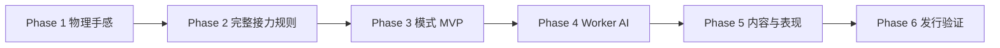

# FlickChain 任务计划 V0.7

日期：2026-10-13｜feature：flickchain-web-3d｜模式：完整规划｜状态：active（连续随机单人/本地对战、英文发行适配、用户动画手、圆桌及 CrazyGames SDK 本地集成已实现；Portal Preview、真机与阶段出口验收待完成）

当前进度以 [PROGRESS.md](PROGRESS.md) 为准。单人改为连续随机轮，无选关；继承刚体、三次复活、最高分、铁币/大理石/玻璃杯已接入。最新验证见PROGRESS；旧五布局完整解仅保留生产回归。原20固定关计划被随机轮体验验证取代。Worker AI已接入；`dev_en` 已完成英文运行文本、CrazyGames SDK v3 生命周期、Basic Launch 本地上传包及三张封面。真机/性能、预览视频、Developer Portal Preview、排行榜、广告复活与正式发行仍未完成。

2026-10-10 交互迭代完成：点币即时开始、弹射前可切换当前币、按住手指按时长蓄力、金币表现与金属感音效；单测与真 GPU 浏览器验证全绿，见 [交互 v2 验证记录](validation/2026-10-10-interaction-v2.md)。

2026-10-10 后续修正：入关/换人后仅首杆发射前自由换币，合法接力锁定刚命中的币；手指待机沿发射方向位于金币正后方、平行桌面，按住逐渐弯曲。交互 v2 是历史验证记录，其“每杆发射前均可换币”不再作为当前规则。

同日表现补充：完整卡通握拳手、食指蓄力弯曲与高蓄力微抖，选币后平滑推近镜头；选币、接力与物理参数沿用前述规则。

同日模型迭代：按用户参考图通过 Blender MCP 制作 low poly 握拳手，绑定食指三节骨骼及 `FlickCharge`，已用真实 GLB 替换程序化手。76项测试、构建、鼠标和模拟触摸通过，见 [骨骼手验收](validation/2026-10-10-rigged-hand.md)。

同日后续修正：用户要求消除手部破损，食指与拳头一体，默认圆桌。已重做连续皮肤网格与食指辅助骨骼，并同步圆形渲染、输入、物理与关卡边界；本轮验收见 [连体手与圆桌记录](validation/2026-10-10-continuous-hand-round-table.md)。

## 1. 任务契约

目标：按 [PRD](PRD.md) 建立可试玩的公共硬币接力游戏，再按阶段扩展 AI、材质、关卡和发行。技术边界见 [架构](TECHNICAL_ARCHITECTURE.md)，需求来源与新增默认值见 [决策记录](SOURCES_AND_DECISIONS.md)。

当前目录开始时为空，2026-10-09 已建立首个可玩版本。下列清单保留完整规划契约，实际路径与已执行边界见 [MVP 验证记录](validation/2026-10-09-mvp.md)。

首个完成点：Phase 3 MVP 可从菜单进入 连续随机清盘轮与本地对战，正确完成弹射、接力、失败、结算、重试、返回和进度恢复。后续 Phase 4–6 分别验收，不把原型完成当作发行完成。

范围外：联网、服务器、付费基础设施、运行时大模型、排行榜、UGC 编辑器、移动机关、混合摩擦区域、广告变现、自动平台提交。

## 2. 责任与执行方式

| 角色 | 责任 | 模型 / 强度 |
|---|---|---|
| 主协调者 | `src/app/`、`src/types/`、包/锁文件、入口、构建配置、接线与最终交付 | gpt-6.1-sol / high |
| physics-gameplay-engineer | `src/physics/`、`src/core/`、`src/gameplay/`、`src/modes/`、对应测试 | gpt-6.1-sol / high |
| presentation-engineer | `src/rendering/`、`src/input/`、`src/ui/`、音效和交互验证 | gpt-6.1-sol / xhigh |
| ai-level-engineer | `src/ai/`、`src/content/`、`public/levels/`、解回放 | gpt-6.1-sol / high |
| platform-engineer | `src/platform/`、存档与打包/兼容检查；共享构建文件由主协调者应用 | gpt-6.1-sol / high |
| test-reviewer | 独立只读审查和验收证据复核 | gpt-6.1-sol / xhigh |
| repo-scanner | 已有代码与调用链检索，当前不需要探索空源码 | gpt-6.1-sol / low |
| escalation-engineer | 重复失败或跨系统疑难定位，默认只读 | gpt-6-astra / high |

主协调者先执行 dev gate、rule_search/vault_search 并注入约束。最多主 agent 加三个子 agent，禁止嵌套委派。共享接口先串行确定；下表路径是归属候选，实际委派仍要逐文件明确。材料数据与 MaterialRegistry 实现由不同角色负责，禁止同时修改注册表。浏览器与部署共享状态串行操作。

## 3. 阶段与依赖

每阶段出口未满足时继续修复当前阶段。Phase 3 后可并行整理素材/关卡草案，AI 与材质定稿需共用冻结版本的物理配置。没有工作量实测，暂不承诺日历交付时间；每阶段集成后再更新估算。

## 4. 任务清单

T01–T03、T05–T11 已实现；T04/T12 部分验证，真实设备、性能矩阵、完整人工关卡记录待核销。T13–T15/T19–T21 仍 TODO；T16–T18 材质/随机轮/表现已部分实现，真机与难度待验证。输入 → 处理 → 输出为实施契约；验收编号见 §5，测试编号见 §6。失败时按“回查点”定位，不绕过阶段门禁。

### Phase 1：物理与操作原型

| 任务 | 责任与拟建路径 | 输入 → 处理 → 输出 / 不变量 | 依赖、验收与回查点 |
|---|---|---|---|
| T01 工程与共享契约 | 主协调者；`package.json`、锁文件、`tsconfig.json`、`vite.config.ts`、`index.html`、`src/types/contracts.ts`、`src/app/bootstrap.ts` | 决策 D-01/06/07 → 选择并锁定依赖、定义 CoinId/ShotCommand/WorldState/ShotResult/LevelConfig → 可启动工程与类型检查；不接平台服务 | 无；AC01/TST01；回查导入/初始化/资源基址 |
| T02 权威物理世界 | 物理；`src/physics/PhysicsWorld.ts`、`PhysicsStepper.ts`、`MaterialRegistry.ts`、`CollisionCollector.ts` | 统一单位及物理配置 → 木桌、圆柱币、障碍、重力、CCD、映射、固定步 → 无渲染模拟世界；质量实际参与动量 | T01；AC01/TST02；回查单位、质量重复叠加、CCD、step配置 |
| T03 呈现与瞄准 | 表现；`src/rendering/SceneManager.ts`、`src/rendering/FlickFinger.ts`、`src/input/PointerInput.ts`、`src/ui/` | 权威世界 → 透视相机轨道、空白拖动旋转、点币即时聚焦、连体手按时长蓄力与视角前方命令 → 鼠标/触摸候选命令；不得拖动币位置或修改规则 | T01/T02；AC02/TST03；回查坐标投射、camera锁、接力锁币、pointer capture |
| T04 物理手感集成 | 主协调者接线；`src/app/GameApp.ts`；物理负责 `tests/physics/`，表现负责交互记录 | 3/10/20币固定布局 → 验证轻/中/重力度、擦边、反弹、掉落及60/120Hz → 配置候选和性能记录 | T02/T03；AC01/02/TST02/03/10；回查物理积压与渲染耦合 |

出口：不同力度有清晰差别、动量可传递、测试布局无穿透、桌面可操作，固定物理步与渲染帧率解耦。记录真实设备，不以桌面模拟触摸替代手机验收。

### Phase 2：整杆规则与状态

| 任务 | 责任与拟建路径 | 输入 → 处理 → 输出 / 不变量 | 依赖、验收与回查点 |
|---|---|---|---|
| T05 整杆事件和判定 | 物理/玩法；`src/gameplay/ShotResolver.ts`、`src/physics/CollisionCollector.ts`、`tests/gameplay/shot-resolver.test.ts` | shotId、逐步碰撞/掉落 → 只从源币 A 的直接接触去重目标，犯规优先、静止/超时 → 严格ShotResult；A-B 后 B-C/D 合法，A 直接 B/C 才犯规 | T04；AC03/04/TST04/05；回查事件启用、handle失效、初始化污染 |
| T06 会话与接力提交 | 玩法；`src/core/GameSession.ts`、`src/gameplay/ShotController.ts`、`tests/gameplay/session.test.ts` | 结算结果 → 删A前预检其余币固定支撑安全、同一事务+1/移除A/接管B或犯规零分 → 新revision；每杆一次；预检失败不删不加分进ERROR | T05；AC03/05/TST05；回查状态转换和提交幂等 |
| T07 全流程反馈和生命周期 | 表现+主协调者，分别 `src/ui/` / `src/input/` 与 `src/app/GameApp.ts` | 状态/事件 → 光环、分数、即时犯规、pointer取消、暂停/返回/重试 → 新session清理；无旧输入或异步污染 | T06；AC02/05/TST03/06；回查共享操作权门禁、销毁顺序 |

出口：规则矩阵通过；输入仅在合法人类回合开放；低速连续步静止判定包含全场及稳定支撑；犯规立即反馈但不提前开启下一杆。

### Phase 3：Challenge 与 Local Battle（首个 MVP）

| 任务 | 责任与拟建路径 | 输入 → 处理 → 输出 / 不变量 | 依赖、验收与回查点 |
|---|---|---|---|
| T08 关卡数据入口 | 关卡；`src/content/LevelLoader.ts`、`LevelValidator.ts`、`public/levels/`、`tests/levels/` | 版本化JSON → 校验单位/ID/材质/主控/边界/重叠 → 随机配方与避让；非法配置可重开/返回 | T01/T06；AC06/TST07；回查schema、初始静止和配置hash |
| T09 单人完整闭环 | 玩法；`src/modes/ChallengeMode.ts`；表现负责菜单/结果UI | CLEAR_ALL → 任意犯规失败、合法最后一杆通关 → 自动保留幸存币换轮/三次复活/重开/返回；掉落减到1币不可通关 | T07/T08；AC07/TST06/07；回查犯规与目标优先级 |
| T10 本地对战 | 玩法；`src/core/GameSession.ts`；表现负责比分/交接/选币UI | PVP/PVE选择、同材质空桌比远先手 → 随机9币/1–5杯 → 合法接力锁B/失误换手 → PVP/PVE10分获胜；耗尽保留残局，PVP补9/PVE新增8 | T07/T08；AC08/TST06；回查源币存活、选币门禁与终局优先级 |
| T11 教学、音效与存档 | 表现 `src/ui/` 音效；平台 `src/platform/SaveAdapter.ts`；主协调者接线 | 首次操作/成绩 → 教学、交互解锁音频、版本存档及损坏恢复 → 可保存最高分、声音设置 | T09/T10；AC09/TST03/08；回查存档异常与音频许可 |
| T12 MVP独立验收 | test-reviewer只读；主协调者运行需写检查并保存证据 | 当前实现及测试报告 → 回归核心链/菜单/返回/重复重试 → MVP验收报告与修复项 | T11；AC01–09/TST01–08；任何P0/P1阻断出口 |

出口：随机配方、初稳、继承/复活与人工体验分别验收；单人/双人完整闭环和存档可用。尚未要求AI、20关或平台提交。

### Phase 4：Worker AI（单档已实现，三档难度待调校）

| 任务 | 责任与拟建路径 | 输入 → 处理 → 输出 / 不变量 | 依赖、验收与回查点 |
|---|---|---|---|
| T13 Worker与快照协议 | AI；`src/ai/AIClient.ts`、`BattleWorker.ts`、`tests/ai/`；主协调者维护共享types | 物理快照+映射/配置+session/revision → 隔离恢复/预算/取消/释放 → 只返回coinId/direction/power，不改live world | T12；AC10/TST09；回查buffer所有权与旧回包 |
| T14 搜索与难度 | AI；`src/ai/BattleSearch.ts`、难度数据；玩法复用ShotResolver | 直射/一次反弹候选 → 同物理完整模拟+终点价值评分 → Easy/Normal/Hard；无合法解可执行合法失误杆，不改棋盘作弊 | T13；AC10/TST09/10；回查搜索预算与预测漂移 |
| T15 人机模式接线 | 主协调者+表现，`src/app/GameApp.ts`与UI；AI负责AIClient，复用GameSession | 玩家类型 → AI回合关闭人类命中框、掉A后AI合法选币再搜索、暂停恢复重发失效请求 → 人机完整对局；人类READY与AI_THINKING合法发射分别验证 | T14；AC05/10/TST06/09；回查输入所有权和取消 |

出口：预测与实玩同配置一致（容差与环境记录），AI计算不卡主线程，重试/退出能取消，难度测试体现可观察区别。

### Phase 5：材质、随机轮与表现

| 任务 | 责任与拟建路径 | 输入 → 处理 → 输出 / 不变量 | 依赖、验收与回查点 |
|---|---|---|---|
| T16 材质扩展 | 关卡负责材质数据；物理负责MaterialRegistry；表现负责材质网格 | 标准/石/塑料与木/玻璃/冰 → 调校质量/接触摩擦/阻尼 → 可辨识物理和视觉；实玩/AI参数唯一 | T15；AC11/TST02/09；回查combine rule和超时 |
| T17 内容验证 | 关卡；`public/levels/`、`tests/levels/`、解回放工具 | 随机配方 → schema+初稳+继承/复活+人工试玩 → 连续轮与难度证据；不以N-1杆给通用三星 | T16；AC06/11/TST07；回查物理版本导致解失效 |
| T18 视觉与声音完成 | 表现；rendering/ui/input及授权素材 | 微缩桌面方向 → 币模型/光影/音效/短辅助/反馈 → 手机可读可操作界面，降级开关 | T17；AC02/09/11/TST03/10；回查像素尺寸、遮挡及资源生命周期 |

出口：随机轮全链体验验证；素材许可可追溯；低品质不改变规则、碰撞体或物理配置。

### Phase 6：性能、静态构建与平台

| 任务 | 责任与拟建路径 | 输入 → 处理 → 输出 / 不变量 | 依赖、验收与回查点 |
|---|---|---|---|
| T19 性能/兼容和构建 | 平台+主协调者；platform与构建配置，`docs/validation/` | 固定浏览器/设备矩阵 → wasm/worker/base路径、压缩、DPR与阴影降级 → 静态包和实机报告 | T18；AC12/TST01/10/11；回查资源404、初始化失败、内存增长 |
| T20 平台适配准备 | 平台；`src/platform/`；主协调者应用共享接线 | 当期官方要求 → SDK适配器/生命周期/平台存档（适用时） → 本地仍可脱离portal；广告仅对应授权发行阶段 | T19；AC12/TST11；回查当前SDK与Portal要求 |
| T21 发布交付 | 主协调者；平台提供检查，test-reviewer独立复核 | 已验收包+封面/描述/视频 → 授权范围内部署/Preview/提交 → 逐层证据、实际状态 | T20；AC12/TST11；平台提交和付费服务需对应用户授权 |

出口：构建、线上站点、Preview、正式提交/上线分别记录；某层未执行明确标记，不把包检查当发布。预览视频先查看连续玩法与关键帧，再上传。

## 5. 产品验收与需求映射

| AC | 关联PRD | Given / When / Then | 验证 |
|---|---|---|---|
| AC01 | FC-11 | 固定布局与物理配置；改变渲染节奏；按相同物理步结果在记录容差内一致，且无明显穿透 | TST01/02/10 |
| AC02 | FC-06 / FC-07 | 人类可操作；空白拖动旋转透视视角、确认选币后拖动当前币蓄力并释放或取消；合法命令仅一次，取消零杆，相机/UI适配不改物理 | TST03 |
| AC03 | FC-01 / FC-02 | A只涉及B；全场安全静止；+1一次，删A一次，B终点继承且同玩家继续；重复A-B合法 | TST04/05 |
| AC04 | FC-02 / FC-03 | A-B 后 B-C/D 合法；A 直接多目标、任意掉落或TIMEOUT；发生/结算；零分犯规，立即反馈且不能提前开启下一杆；超时非法支撑冻结进入ERROR，仅可重建/返回 | TST04/05 |
| AC05 | FC-06 | 运动、结算、AI、暂停或终局；点击/旧回包/重试；无非法发射、重复提交与旧会话污染 | TST03/05/06/09 |
| AC06 | FC-08 | 随机配方/旧固定解/错误配置；加载/重放；随机布局/继承/复活符合约束，固定解可重放，错误配置可重开 | TST07 |
| AC07 | FC-04 | Challenge；合法清至1币或犯规导致剩1币；前者自动换轮保留幸存币，后者失败；仅三次复活可保留残局，重开从随机第一轮 | TST06/07 |
| AC08 | FC-05 | Battle残局；成功/犯规/源币落/≤1币；继续/换人/选币/PVP补9/PVE新增8；10分终局，开局同距重比 | TST06 |
| AC09 | FC-07 / FC-08 | 存档损坏或声音未解锁；加载/用户交互/关卡完成；安全恢复、可静音、成绩可靠保存 | TST03/08 |
| AC10 | FC-09 | AI同版本快照；搜索并执行；预测同判定、live world不变、限预算、取消生效且无人类输入 | TST09/10 |
| AC11 | FC-10 / FC-08 | 混合硬币或整桌材质；相同输入；动量/滑行差异参与物理，随机轮稳定性与人工体验记录完整 | TST02/07/09 |
| AC12 | FC-11 / FC-12 | 目标设备/静态产物/授权平台；完整游玩发布流程；满足已登记门槛并清晰标注每层实际状态 | TST10/11 |

## 6. 验证计划（执行结果见验证记录）

T01 已建立 `npm run typecheck`、`npm test`、`npm run build`、`npm run dev`、`npm run preview`；建议以 Vitest 做规则/物理检查。TST03 可用浏览器交互工具；只在需要重复自动化时引入浏览器测试依赖。下列脚本名称为拟建契约，安装后应逐项核对。

| 测试 | 拟建入口 / 前置 | 场景与精确断言 | 失败指向 |
|---|---|---|---|
| TST01 | typecheck/build；已锁依赖 | 0类型错误；产物能加载本地WASM，P4后含Worker资源；preview启动后到菜单可交互 | T01/T19 |
| TST02 | `tests/physics/`；指定版本/固定dt | 轻中重力度滑行有差别；不同质量改变动量；擦边/高速无穿透；同输入按步重放位置在fixture容差内 | T02/T04/T16 |
| TST03 | 浏览器；手机/PC布局与人类回合 | 旋转视角、起手/换人选币确认、沿视角前方拖动释放一杆；pointercancel/Esc/失焦零杆；overlay不能穿透；9:16/16:9无重叠，全部主要状态可读 | T03/T07/T11/T18 |
| TST04 | `shot-resolver.test.ts`；构造事件及真实物理fixtures | A-B成功；A-B反复成功；A-B 后 B-C/D 仍成功；A同时直接B+C失败；墙后B成功；任意币掉落失败；无命中MISS；TIMEOUT不计分 | T05 |
| TST05 | `session.test.ts`；session/shot/revision | 首碰不删A不加分；终态B位置继承；重复提交不加分；删A预检失败不修改币/分数进ERROR；旧revision无效；全场含空中币不可伪静止；超时稳定支撑可恢复，非法支撑进ERROR且不开放下一杆/不凭空删币 | T06 |
| TST06 | 模式/浏览器；连续随机轮和本地对战 | 单人合法末杆成功、犯规末杆失败；PVP/PVE比远先手/连续得分/犯规换人/掉源币选币/零一币PVP补9/PVE新增8与10分终局；20次重试返回无旧UI或资源持续增长 | T07/T09/T10/T15 |
| TST07 | `tests/levels/`与拟建 `npm run validate:levels` | schema拒绝重ID/无主控/NaN/越界/初始重叠；随机配方/避让/初稳/继承/复活回归；旧固定解N-1杆、配置hash匹配；人工体验另验 | T08/T17 |
| TST08 | 存档单测+浏览器 | 无存档/坏JSON/旧版本/写入失败可玩；最高分保存；设置刷新恢复；不保存半杆物理状态 | T11 |
| TST09 | `tests/ai/`；Worker与正式物理同配置 | 候选不污染live；buffer未被detach；预测/执行outcome一致，位置容差明示；人类掉A→AI选币→搜索→合法发射；暂停恢复重选/重搜，旧回包无提交；AI_THINKING拒绝人类命令但接受有效AI命令；clone可释放 | T13/T14/T15 |
| TST10 | 设备性能记录 | 按固定布局3/10/20币、品质与AI档测帧时间p50/p95、物理耗时、AI耗时、加载和内存；后台恢复不追赶海量步骤 | T04/T14/T19 |
| TST11 | preview/线上/Portal分层 | 子路径WASM/Worker无404；断网首次加载失败可恢复，加载后离线可玩；授权部署核验HTML/资源/流程；平台Preview独立验收 | T19/T20/T21 |

证据记录拟写入 `docs/validation/YYYY-MM-DD-phase-N.md`：版本、浏览器/设备、固定dt、physics hash、命令/步骤、预期/实际、日志/截图/视频、已执行边界。真实触摸与性能要注明设备型号，不记录为模拟触摸。

## 7. 风险、暂停条件与回退

| 风险 | 可观察信号 | 处理与回退 |
|---|---|---|
| R01 碰撞遗漏/误判 | A 直接击中多个目标仍得分、高速穿透 | 回查T02/05；保留事件fixture；阻断后续关卡扩展 |
| R02 调参使关卡解失效 | 旧解hash不符或不能清盘 | 回查T16/17；回退配置版本或重新验证全部受影响解 |
| R03 AI克隆泄漏/旧结果 | 连续对局内存增长、退出后发射 | 回查T13；禁用人机入口回到已验收本地模式 |
| R04 UI权属分叉 | 隐藏控件仍能发射、AI回合光环提示人类 | 回查T07/15；修共享canHumanAct门禁并重走全部状态 |
| R05 手机性能不足 | p95帧时间/物理积压超门槛 | 回查T04/19；降DPR/阴影/效果，不能只为低端设备改变规则 |
| R06 犯规战术压过技巧 | 试玩频繁故意推落、对局僵持 | 记录玩法反馈，提出规则修订再验证；不临时回滚残局 |
| R07 平台要求变化 | SDK/上传/广告规定与旧方案不符 | Phase6刷新官方要求，先完成本地包；平台未授权则停在可审查交付物 |

每任务在独立验收后记录完成证据。发现阻断问题时标为 BLOCKED 并写原因，不把规划文件状态改成实施完成。

## 8. 待定项与范围审计

Phase 1 需登记基准手机/浏览器、选择依赖确切版本、固定dt与碰撞参数；Phase 4 需实测AI预算；Phase 5 需素材来源；Phase 6 需平台当期要求及发布授权。它们是相应阶段的出口条件，不阻止开始物理原型。

完成阶段时核销：任务→路径/改动→PRD FC编号→AC→TST→证据→风险。共享类型/包文件仅一个writer；非计划范围改动先记录原因。Phase 4的AI难度/手机预算、Phase 5的真机体验和Phase 6的CrazyGames交付仍待执行；Pages构建发布流程见PROGRESS。构建、桌面、真机与平台各层分别验收。

修订历史：2026-10-09 V0.2，迁入源聊天方案，收敛MVP、明确超时/平局默认值并建立角色与验收映射。
