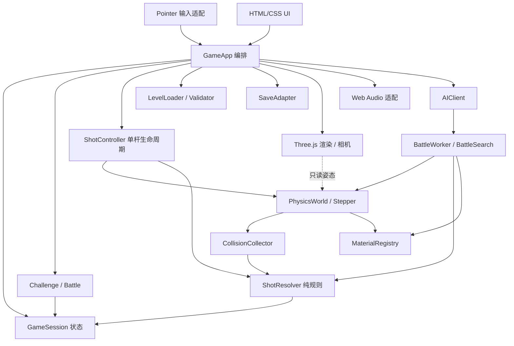
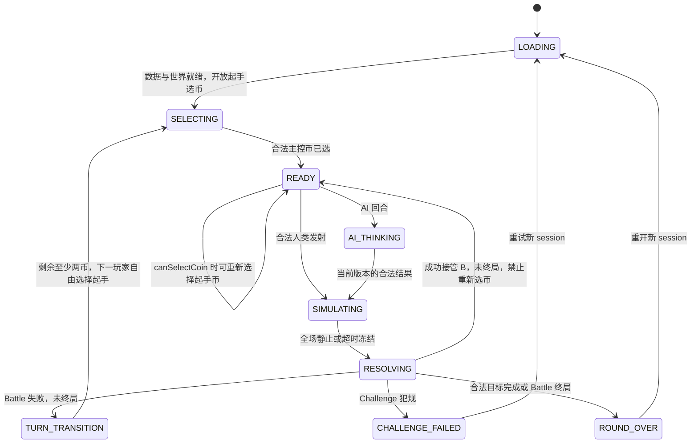

# FlickChain《一弹到底》技术架构 V0.6

版本：V0.6 · 日期：2026-10-11 · 状态：MVP与Pages构建发布流程已实现，PVP/PVE与Worker AI已接入，CrazyGames模块保留规划契约。

本文件把产品规则转为模块边界和实现契约。产品范围以 `docs/PRD.md` 为准，阶段任务以 `docs/TASK_PLAN.md` 为准；若三份文档冲突，应先统一契约再实现。生产实现与验证范围见 [开发进度](PROGRESS.md) ；手模型/音效历史证据见 [前一版验收](validation/2026-10-11-hand-physics-audio.md)。下方目录、接口草案及AI/Worker、平台章节仍包含规划，不能把预留模块当成已实现能力。

## 1. 依据与设计状态

| 项目 | 状态与来源 |
| --- | --- |
| Web 3D、所有硬币公共、Challenge 任意犯规失败 | 项目聊天「小游戏玩法设计」及用户修正，视为硬约束 |
| TypeScript + Vite + Three.js + Rapier 3D WASM，HTML/CSS、Pointer Events、Web Audio | 源聊天技术方向及项目约定 |
| 整杆判定、静止后移除 A、接管 B 终点、保留 Battle 残局 | 产品规则契约，所有模式共用 |
| Battle先5分、比远争先、TIMEOUT零分安全结算后换人 | 2026-10-11用户规则，V0.6；比远与补币细则见PRD §5 |
| 120 Hz、静止阈值、材质系数、AI 搜索预算、画质档位 | 调校候选，必须以实际模拟和手机验证决定 |
| 连续随机轮、单档PVE、后续平台接入 | 分阶段交付范围，不能提前当成已验证能力 |

初期运行完全离线：不需要账号、服务端或平台 SDK。未来联网只预留边界，不加入 MVP 开发链。画面为精致微缩桌面／玩具摄影感，先用木桌与标准硬币。竖屏 9:16 与桌面横屏 16:9 改变相机、布局和画质，不改变桌面几何、材质、力度范围或规则。

## 2. 分层与依赖方向

核心是无 Three.js、DOM 和浏览器事件依赖的状态与规则。Rapier 类型封装在物理适配层；Core 和规则使用项目自己的数值结构、稳定 ID 和事件。实际物理适配层可在主线程与 Worker 中复用。



箭头表示调用／数据依赖，不表示各模块可互相写状态。只有 `GameSession` 通过合法命令提交业务状态；只有 `PhysicsWorld` 创建、推进、删除物理对象。渲染消费只读姿态，不能把 Mesh 位置写回物理。模式负责胜负与换人，不复制碰撞判定。UI 展示状态，不自行推断是否轮到玩家。

### 2.1 目录规划及职责

```text
src/
  types/contracts.ts             共享 DTO、命令、事件、版本与错误类型
  core/GameSession.ts            状态、分数、主控币、提交幂等性
  physics/PhysicsWorld.ts        Rapier 初始化、实体映射、快照与销毁
  physics/PhysicsStepper.ts      固定步时钟、静止检测、超时终止
  physics/CollisionCollector.ts  接触归一化、全杆去重、掉落检测
  physics/MaterialRegistry.ts    唯一物理／表现材质定义源
  gameplay/ShotResolver.ts       无环境依赖的整杆判定
  gameplay/ShotController.ts     发射、收集、锁定、结算与清理
  modes/ChallengeMode.ts         目标、失败、重试与关卡完成
  modes/BattleMode.ts            玩家、连续得分、换人、终局
  app/GameApp.ts                 启动、模块连接、暂停、恢复、重开
  ai/BattleWorker.ts             Worker 消息与物理 clone 生命周期
  ai/AIClient.ts                 请求版本、取消、结果验证
  ai/BattleSearch.ts             候选生成、评分、搜索预算
  content/LevelLoader.ts         数据读取、版本解析
  content/LevelValidator.ts      结构、几何、目标和解回放验证
  rendering/                    场景、相机、Mesh、光影、插值
  input/                        Pointer 手势、桌面投影、输入取消
  ui/                           菜单、HUD、模式提示、结果与无障碍
  platform/SaveAdapter.ts        本地进度、设置、迁移；后期平台适配
public/                         静态资源；不保存运行状态
tests/                          纯规则、生产物理回归、生命周期测试
```

主协调者拥有 `types/`、`app/`、包及构建配置和跨模块连接。物理／规则、表现、AI／内容、平台分别按项目角色分工；共享接口先由主协调者定稿。上述文件尚未存在时也不得多人同时创建不同版本的契约。

## 3. 坐标、单位与输入契约

本节命令DTO及后面的大写状态图是逻辑规划。实际入口使用contracts.ts的ready/selecting/simulating/paused/refilling等状态；电脑思考保持ready/selecting，以inputOwner=computer关闭人类控制，GameApp校验当前有效决策后调用同一Core选币/发射方法，详见§6–7。人类正式杆按相机方向；比远锁定默认-Z，电脑按搜索返回方向。

采用右手世界坐标：桌面为 XZ 平面，Y 向上。内部统一 SI：长度 m、时间 s、质量 kg、线速度 m/s、角速度 rad/s、冲量 kg·m/s。美术可用缩放后的视觉尺寸，但输入、判定与 Rapier 只使用世界单位。硬币半径、厚度、质量、重心、桌面尺寸及重力放入版本化配置，禁止散落在渲染或 AI 中。

`campaign-materials-v4` 最大冲量0.048 N·s，保持1.25秒蓄满及原力度曲线。外层生产步长为120 Hz，每步由两个240 Hz Rapier内步聚合碰撞/掉落事件，避免满力度撞入薄挡板。桌边只在重心实际越界或真实离桌后解锁倾倒，不因币缘悬伸或单次支撑接触缺失而解锁。开局落桌是 `CoinArrival` 呈现动画，稳定物理布局不变；入场未完成时由GameApp统一锁定输入，落稳后恢复选币。真实碰撞及落桌短录音通过Web Audio加载，出处见 `assets/audio-sources.md`；滑音仅根据桌面上的水平移动渐变，静音/暂停/销毁停止声音。

握拳手使用用户调整的 `blender/pointing-hand-rigged.blend`，经 `scripts/export-pointing-hand.py` 导出为 `public/models/flick-hand.glb`；`assets/flick-hand.blend` 是独立的游戏适配副本。保留原始网格、三节食指骨骼、拇指及蒙皮权重，导出副本统一骨名、尺度与 +Z 发射朝向，手背朝 +Y、手心朝桌面，将 `Index_Curl` 的12–36帧采样为0–30帧、30fps的一秒 `FlickCharge`；运行时按蓄力进度采样，不播放原动作的等待和回正段。glTF 使用线性蒙皮，原 Blender 源的保体积设置保持不变。按真实变形网格校准桌面净空；待机点击轴高度从资产取得，不绑定旧模型的0.025米。GameApp 在创建会话前等待 SceneManager 加载模型；加载失败保留请求参数供错误按钮重试。FlickFinger 用 AnimationMixer 采样食指动作，拳体固定，高蓄力抖动只作用于外层节点。输入点来自骨骼标记和真实蒙皮表面，CPU查询使用与渲染相同的 `updateMatrixWorld` 更新绑定逆矩阵。销毁中止下载并释放迟到解析结果。该资产仅影响呈现与点击，不进入物理世界。

桌面契约支持 `shape: 'circle' | 'rectangle'`，省略时兼容旧矩形数据；圆桌宽深相等，表示直径。`TableGeometry` 提供形状一致的内侧距离与点包含判断，物理支撑/边缘解锁、关卡校验、渲染标识和输入共用。圆桌使用 Rapier 圆柱碰撞体，上表面Y=0；渲染使用圆柱，默认连续轮与旧五布局直径1.6米，并重新生成生产解法回放与指纹。

呈现层使用 `THREE.PerspectiveCamera` 的 3D 透视视角。空白桌面上的 Pointer 拖动改变相机 yaw/pitch；相机当前 forward 投影到 XZ 平面，作为唯一的弹射方向来源，保证“弹出去始终是当前视角前方”。起手和每次换人先进入 `selecting`：点击任意仍在桌上的公共硬币立即进入 `ready`，镜头平滑跟随，不需二次确认；首杆发射前 `canSelectCoin` 为 true，可反复换起手币。发射后关闭该许可，合法接力锁定刚击中的币。手指沿发射方向放在当前币正后方，待机平行桌面，按住手指或当前币时逐渐弯曲指节；`power01` 由按住时长决定，松手沿相机前方发射，不由拖拽距离决定。输入使用实际关节世界坐标构建手指命中区，硬币点击优先。固定发射模型不增加自由打击高度或偏心旋转控制；起发时长阈值、满蓄时长、相机灵敏度与最大冲量仍需设备调校。

无效输入必须在调用物理前拒绝：NaN／Infinity、零方向、超范围力度、未知／已删除 coinId、错误玩家、错误 sessionId／stateRevision、未获发射权限、第二根指针。有限且合法的力度可按约定限幅；结构错误不静默修正。`pointercancel`、失焦、切模式、暂停、重开和视口变化取消未释放的手势，不产生一杆。开始 AI 请求时也取消人类手势。

区分人类 UI 门禁与统一命令接收门禁：`canHumanAct` 仅在 READY 且当前 owner 为人类时成立；`acceptShot` 接受此状态下的人类命令，或 AI_THINKING 下当前 AI owner、requestId、sessionId 与 revision 全部匹配的 AI 命令。SIMULATING、RESOLVING、TURN_TRANSITION、SELECTING、暂停、终局与 ERROR 对双方都拒绝发射。AI_THINKING 拒绝人类操作，不拒绝合法 AI 发射；不存在临时把 AI 回合标为人类可操作的窗口。

以下仅为文档中的接口草案，不是已实现代码：

```ts
type CoinId = string;
type PlayerId = 'P1' | 'P2';
type Vec3 = Readonly<{ x: number; y: number; z: number }>;
type SessionPhase =
  | 'LOADING' | 'SELECTING' | 'READY' | 'AI_THINKING'
  | 'SIMULATING' | 'RESOLVING' | 'TURN_TRANSITION'
  | 'CHALLENGE_FAILED' | 'ROUND_OVER' | 'PAUSED' | 'ERROR';

interface CommandStamp {
  sessionId: string;
  stateRevision: number;
}
interface ShotCommandBase extends CommandStamp {
  commandId: string;
  playerId: PlayerId;
  sourceCoinId: CoinId;
  directionXZ: Readonly<{ x: number; z: number }>; // 已归一化
  power01: number;
}
type ShotCommand = ShotCommandBase & (
  | { issuer: 'HUMAN' }
  | { issuer: 'AI'; requestId: string }
);
interface ShotContext {
  sessionId: string;
  shotId: string;
  startRevision: number;
  playerId: PlayerId;
  sourceCoinId: CoinId;
  startStep: number;
  configVersion: string;
  ruleVersion: string;
}
interface PhysicsEvent {
  sessionId: string;
  shotId: string;
  step: number;
  sequence: number;
  kind: 'COIN_CONTACT' | 'ENV_CONTACT' | 'COIN_FELL';
  coinIds: readonly CoinId[]; // 接触 pair 按稳定 ID 规范排序
  environmentId?: string;
}
interface ShotResultBase {
  sessionId: string;
  shotId: string;
  sourceCoinId: CoinId;
  fallenCoinIds: readonly CoinId[];
  foulReasons: readonly string[];
  terminalStep: number;
  termination: 'WORLD_SETTLED' | 'TIMEOUT_FROZEN';
  finalCoinTransforms: Readonly<Record<CoinId, {
    position: Vec3;
    rotation: Readonly<{ x: number; y: number; z: number; w: number }>;
  }>>;
}
type ShotResult =
  | (ShotResultBase & {
      status: 'SUCCESS';
      targetCoinId: CoinId; // 合法成功必须有唯一 B
      fallenCoinIds: readonly [];
      foulReasons: readonly [];
      termination: 'WORLD_SETTLED';
    })
  | (ShotResultBase & {
      status: 'MISS' | 'FOUL' | 'TIMEOUT';
      targetCoinId?: never; // 失败无有效接管目标；接触事实留在事件记录
    });
```

实际接口应采用判别联合，禁止 SUCCESS 无目标、SUCCESS 带掉落／超时，或失败带有效接管目标等无效状态。`shotId` 只在合法命令被接受后生成，`commandId` 用于防止重复释放，`stateRevision` 每次业务状态提交单调增加。所有异步回调同时校验 sessionId、shotId 和对应 revision；旧 UI 命令、旧指针释放、旧 Worker 结果和旧世界事件只能丢弃，不能影响新局。`ShotResult` 只提交一次。

## 4. 物理世界与固定时钟

### 4.1 物理对象

标准币使用真正的动态 3D 圆柱刚体，保留重力、Y 轴平移与离桌掉落；木桌和普通墙／障碍使用固定碰撞体，掉落区域使用传感器及高度兜底。桌面稳定方案初选为：在稳定桌面支撑上锁定 X／Z 转动，允许 Y 旋转；失去该支撑后解锁 X／Z，让硬币自由翻落。该约束来自源方案，是待原型验证的显式设计，不声称币在桌上具有完全自由的翻滚物理，也不把世界替换为二维碰撞。

支撑状态切换在固定物理步边界进行，需防止桌边反复锁定／解锁和姿态突跳；是否允许重落桌面的币重新稳定锁定，以及稳定确认步数，在阶段 1 测试后定稿。约束状态及切换参数纳入 PhysicsConfig／快照，实玩、AI 和回放共同使用。优先用简单凸形状，模型细节由 Mesh 表现。圆柱、凸体与传感器能力以 [Rapier Colliders 官方说明](https://rapier.rs/docs/user_guides/javascript/colliders/) 为依据；具体包版本和碰撞配置在安装时核对并锁定。

每个币拥有独立、不可复用的 `coinId`；建立 `coinId ↔ rigidBodyHandle ↔ colliderHandles` 映射。Rapier handle 不作为业务 ID，也不持久化为关卡 ID，因为已删除对象的 handle 可被引擎复用。销毁时清理双向映射、接触缓存及渲染实体；事件应在删除前转换为稳定 ID，并验证所属世界世代。

`MaterialRegistry` 是材质单一来源：materialId、版本、质量或密度、摩擦、恢复系数、组合规则、阻尼候选及视觉／音效引用。注册表校验有限值、物理范围和引用；表现参数与物理参数明确分栏。实时世界、AI 和解回放使用相同物理参数。不得在 AI 中提高摩擦以缩短搜索，再把结果当成真实解。

最大冲量、薄币和薄墙需要专门穿透测试，必要时开启并评估 CCD。CCD、求解迭代数和接触配置属于 PhysicsConfig，而不是临时帧级开关。具体最佳组合仍需实测。

### 4.2 步进、积压与暂停

`PhysicsStepper` 使用固定 `dt`。120 Hz 是初始候选，阶段 1 比较 60 与 120 Hz 的穿透、弹性、规则一致性和手机成本后选择。一个已开始的世界不能按渲染 FPS 自动改变 dt；选定配置写入快照、关卡解与回放元数据。

主线程以渲染时钟累计 elapsed，每次按固定 dt 推进若干步，再渲染前后姿态插值。每帧最大子步数、最大累计时间都是显式配置。发生长帧时可以减少渲染工作或让游戏时间暂时慢于墙钟，不能跳过物理步、放大 dt 或漏收碰撞；超出积压上限的墙钟时间按显式策略丢弃并记录指标。规则超时只统计实际执行的模拟步。

切后台、系统挂起或显式暂停：冻结模拟、取消指针、暂停音频、使 AI 请求失效；恢复时清空墙钟积压，回到暂停前的安全业务状态，禁止一次补跑几秒物理。暂停中的 SIMULATING 只能从同一世界继续，不能重新发射。`PAUSED` 保留原 phase 与 shotContext；UI 的暂停是覆盖状态，不丢失当前杆。

AI clone 使用同一 fixed dt 独立推进，没有渲染插值或墙钟积压。每次物理步的顺序固定：推进 → 收集／归一化事件 → 检查掉落 → 更新全场静止计数 → 检查模拟步上限 → 给控制器状态。事件必须在静止／超时判定前消费。

### 4.3 WorldSettled 与掉落生命周期

全场静止不是只看 A，也不是某币瞬间速度低。所有仍参与桌面的动态币须同时满足：线速度与角速度低于阈值、在桌面或允许的稳定支撑上、连续满足 N 个物理步。支撑检测应结合接触／几何检测；跳到最高点的低速币不算静止。睡眠状态可辅助，不能替代支撑和掉落检查。阈值与 N 换算为时间并纳入配置，60/120 比较时保持判定时间意图一致。

coin 生命周期：`ON_TABLE → FALL_CONFIRMED → REMOVED`。越过明确的掉落体积／不可返回高度即记录 COIN_FELL，只记录一次；单纯短暂离地或靠近边缘不是掉落。确认掉落后该币退出可选列表，在物理步之间安全删除，不再等待它落到无限深处。所有币掉落都影响本杆，即使掉落币不是 A 或 B。

正常结算必须等待所有保留币满足 WorldSettled。允许的稳定支撑须来自桌面或关卡明确许可的固定障碍；以 A 或其它动态币为垂直支撑不满足可接力条件。成功提交前检查移除 A 不会破坏 B／其它币的支撑，若检查不成立，保持原世界与零新增得分，进入可恢复 ERROR，不能先删除再尝试判犯规。安全移除 A 后检查 B 的真实位姿与支撑，再开放输入；不得把漂浮币交给玩家。该错误是配置／物理恢复异常，不增加新的正常玩法规则。

### 4.4 防止永不静止：TIMEOUT

每杆设最大模拟步数 `maxShotSteps`，按候选模拟秒数除以 dt 得出。TIMEOUT 不按真实等待秒数触发，暂停和慢设备不消耗额外模拟预算。

达到上限后先消费最后一步事件，再记录 TIMEOUT；本杆零分，不能由已有 A-B 接触转为成功。V0.2 默认把 TIMEOUT 视为犯规：Challenge 失败，Battle 在安全边界内换人。停止该杆物理推进，冻结保留币的终态并清零速度／角速度，只清理已确认掉落币，记录 `termination: TIMEOUT_FROZEN`；不执行成功删 A。禁止发射直到冻结、支撑合法性及业务提交完成。

若所有保留币的终态均有合法稳定支撑，可提交零分残局，在新杆前恢复同一动态世界；恢复不得改变位姿。若存在尚未满足掉落条件的悬空／非法支撑币，保留冻结终态并进入可恢复 ERROR，不换人开放下一杆，不把它凭空归为掉落，也不删除存活 A。提供重建本局／返回菜单，并记录异常证据。未来若增加专门的冻结恢复策略，须先更新规则版本并证明不会造成杆外掉落；当前安全默认不继续该残局。

冻结是超时兜底，不冒充 WorldSettled，也不回滚本杆位置。Battle 使用处理后的终态残局。该路径需专项验收：冻结、额外清理、比分终局及下一个玩家选择不会产生输入窗口。正常成功路径禁止使用冻结来凑足静止条件。

## 5. 全杆事件与规则判定

### 5.1 一杆的采集边界

从发射冲量被接受的物理步开始，到 WorldSettled 或 TIMEOUT_FROZEN 为止。源币使用 CONTACT_FORCE_EVENTS：本内步开始时两币心方向相对速度大于1e-8，且Rapier报告非零接触力，才登记真实命中；每杆以稳定目标ID去重。这样既能识别复活后持续接触的真实推动，又不会把离开接触/预测接触误记为目标。只为当前源币启用力事件，短暂CCD接触也不会因内步末尾流形消失而漏判。其它币及墙仍采集接触开始用于反馈，不能扩大源币目标集合；传感器交叠不能误算命中。每步先用规范化 pair 去除同一币多个 collider 的重复；整杆再用稳定 ID 集合去重目标。事件携带 step 和 sequence，按确定顺序归约，同一步涉及多个目标不能由回调先后决定合法性。

关卡初态禁止硬币相互穿透或以不稳定接触启动。对静止起始接触建立基线：静止持续接触本身不当成命中，但按上述实际推动证据可记为本杆命中，基线也不能掩盖发射后的新增第三币接触。实物几何接触的判定是默认；若需要冲量阈值排除数值抖动，应先形成版本化规则并验证，不在表现层随意滤掉轻碰。

`ShotResolver` 累积整杆接触图与掉落集，但目标集合只取源币 A 的直接 coin-coin 接触。合法候选可以是 A-B，随后 B 再撞 C、D 仍只保留 B 一个目标；反复 A-B 接触仍是一个目标。出现 A-C 或 A 与另一新增硬币的直接接触时，记录额外硬币接触犯规。B-C、B-D 等下游链路不构成额外目标。普通墙／障碍接触只用于物理和反馈，不增加目标，不构成犯规。特殊障碍若未来有规则，须新增明确类型与验收。

### 5.2 早期失败与最终提交

| 情形 | 运行中反馈 | 最终结果与动作 |
| --- | --- | --- |
| A-B，之后静止且无其它接触／掉落 | 可显示待确认命中，分数不变 | SUCCESS：+1，安全移除 A，主控设 B 的物理终点，同玩家继续 |
| A-B 多次，或 A-墙-B | 同上 | 唯一 B，无犯规，SUCCESS |
| A-B 后 B-C/D，或 A 同步直接撞 B/C | 前者继续收集物理事件；后者一旦确定立即锁失败／犯规 | 前者按唯一 B 结算 SUCCESS；后者 FOUL：零分；Challenge 失败，Battle 结算后换人 |
| 没有命中其它币 | 运行中仍等待可能回弹 | 静止后 MISS：零分；模式按犯规处理 |
| 任意币掉落，即使此前命中 B | 一旦确定立即锁失败／犯规 | FOUL：零分；清理掉落币，保留其余终态 |
| 达到最大模拟步 | 立即锁定超时提示 | TIMEOUT：零分，按冻结兜底完成结算 |

Challenge 的失败提示可以在物理仍推进时出现，但“重试”只能在安全结算／清理完成后完整重建世界，同时更换 sessionId，不能直接复用旧世界。退出意图可先记录，安全销毁后再切场景。不能因屏幕显示失败就停止收集已发生的掉落。Battle 的换人提示可以预告，但下一杆输入只能在安全结算并提交后开放。

最终提交是一个业务事务：验证 session/shot/revision → 固化结果 → 更新剩余币／主控币 → 成功时计分一次并移除 A → 根据模式检查终局／换人 → 增加 revision → 发布只读状态。失败不能移除仍留在桌面的 A，也不能重置其它币。重复回调不得重复加分、重复删除、换人两次或打开失效输入。

## 6. 状态机与模式



所有活动状态可进入 PAUSED，数据／WASM／世界错误可进入 ERROR；这些覆盖转移未在图中展开。发射授权遵守第 3 节 `acceptShot`：AI_THINKING 仅接受当前有效 AI 命令，其余禁入状态对双方拒绝。光圈、HUD 玩家名、鼠标／触摸命中区和键盘辅助入口必须从同一 `canHumanAct` 状态派生。SELECTING 使用独立 `canHumanSelect`／选币命令验证，不开放发射。

### 6.1 连续 Challenge

GameApp 持有整次闯关的 round、revivesRemaining（0–3）、transition（clearing/arriving/null）及错误状态；GameSession 持有累计分、当前币、整杆判定与实际世界。Core 不依赖 DOM、Three 或动画时间。首轮由 generateRound(1) 产生 4 金币，直接 selecting。

GameSession.advanceRound(level) 仅在 challenge complete 且唯一幸存币时允许；PhysicsWorld.reconfigure 校验后保留其原 rigid body、位姿和材质，不重建世界，更换杯/桌面摩擦并添加新币。分数、杆数保留，activeCoinId 是幸存币，canSelectCoin=false。

顺序：complete → clearing（ObstacleTransition 抬起挪杯）→ 生成/重配下一轮 → arriving（仅新增币和杯）→ ready。过渡由 App 统一禁止 pick/shoot/retry，允许暂停/菜单；暂停不推进动画。SceneManager.setLevel(level,true) 保留币、相机轨道及相同 ID/几何的杯，beginCoinArrival(newIds) 不重落幸存币。

复活只在已结算 failed、无过渡且剩余机会大于 0 时允许。lastFallenCoinIds 来自最近结算杆，generateRevival 只补该掉落数量的金币；GameSession.revive 保留残局和分数，清掉失败并重新 selecting。仅成功后机会减 1，换轮不重置。无新币时不重落旧杯。重新开始完整销毁旧会话，从随机第一轮开始。

### 6.2 本地Battle：PVP/PVE抢5分

GameApp生成BattleGenerator随机棋盘：木/大理石、1–5杯、9枚金币/铁币。Shell次级选择传入BattleVariant。OpeningSession使用purpose=opening单金币空桌，双方从(0,+0.64)向-Z依次弹射；生产物理停稳测量位移，掉落/超时弃权、1mm同距/双方弃权重试。App显示结果1.3秒再advance，胜者作为GameSession.create的firstPlayer；重新开始创建新随机桌并重比。

GameSession保留完整一杆判定：成功+1并锁定目标B，犯规换人且自由选择公共币。5分优先终局；未到5分剩0–1币进入refilling，GameApp调用generateBattleRefill与session.refill，保留比分/玩家/幸存刚体真实位姿/同桌同杯，补至9币。成功仍锁定B，犯规仍由下家选币；入场期间锁操作，暂停冻结入场。

### 7. Worker AI与生产快照

src/ai/AIClient.ts惰性创建模块Worker入口BattleWorker.ts；BattleSearch.ts使用GameSession.restore逐候选恢复生产物理与完整规则。exportSnapshot仅允许Battle的quiet ready/selecting状态；SessionSnapshot保存view、lastFallenIds与PhysicsSnapshot。物理快照含Rapier字节、稳定ID/刚体/碰撞体映射、材质、支撑/自由/掉落/冻结/发射元数据与新补币信息。恢复重建EventQueue并验证绑定，不重新摆币。新补币仅按验证过的静止支撑初态允许导出，不为快照提前推进幸存币。

自由选币时评估公共源币/目标对，接力时源限定activeCoinId。预算48候选/1.8秒，每候选从相同初态恢复、完整模拟到成功或犯规安全结算。排序考虑成功、终点留位与胜利；无得分解仍返回合法失误输入，实际得分由主世界独立判定。Opening搜索同样复用PhysicsWorld。

AIClient消息ID验证和10秒冷加载watchdog检查Worker错误/返回范围。App同时验证epoch、会话对象、revision、阶段与当前玩家；ai请求不转移live快照buffer。暂停/后台/菜单/重开直接terminate旧Worker、拒绝AbortError并清空缓存，恢复重新搜索。每个clone在finally释放，电脑回合在人类输入入口、PointerInput和SceneManager共同禁止选币/蓄力/视角并隐藏手指。设置/音量仍可用。

Vite使用静态new URL('./BattleWorker.ts', import.meta.url)输出独立Worker资源；生产包与Pages子路径实际检查分别记录。当前一档策略，手机预算和三档难度尚待测量；本机Node耗时不代表手机。

### 7.1 可复现性范围

[Rapier Determinism 官方文档](https://rapier.rs/docs/user_guides/javascript/determinism/) 的一致性有前提：同版本、同初态、同参数与对象增删顺序，初始化数值也要来自一致的计算。项目固定 seed、实体排序、模拟步数、输入序列和所有配置，并保存元数据；不作无条件跨设备精确一致承诺。录制一次发射不等于可在任意未来版本重放。

## 8. 关卡与内容验证

LevelData 至少包含：schemaVersion、levelId、levelVersion、桌面尺寸／障碍／掉落区域、稳定 coinId 列表及初始 transform／materialId、起始主控选择规则、ChallengeObjective、PhysicsConfigVersion、MaterialVersion，以及可选的验证解引用。几何和玩法数据不能从 Three.js 场景反推。

加载分两步：先做结构／引用检查，再用生产物理验证初态。检查唯一 ID、有限数值、正尺寸、单位四元数、有效材质、合法币数、目标可达到的计数范围、币在桌面内、无相互穿透／危险边缘、无无效障碍和初始掉落；创建初态预稳定后记录规范快照，若稳定导致重大布局变化则关卡不合格，不能静默接受。

旧五个固定布局保留生产完整解回归，不证明随机轮可解。原20固定关计划已由连续随机轮取代。SolutionReplay 保存 level/config/material/rule/Rapier 版本、初始快照标识、seed 和逐杆输入语义（sourceCoinId、directionXZ、power01）、预期结果／目标，不保存可直接投递到新会话的运行期命令。

回放驱动先校验上一杆结果、真实终态和当前主控币，再注入当前 sessionId／stateRevision／playerId，生成新的 commandId；需要 AI issuer 时也必须取得当前有效 requestId。通过正常 `acceptShot` 接收门禁发射，不原样复用历史 session/revision，也不绕过状态授权。逐杆从真实上一杆终态继续，禁止把 B 拉回初始位置。验证所有杆不犯规、有效目标达成，记录角度／力度的小幅扰动成功范围；只找到一次数值巧合的解不足以证明适合玩家。

关卡回放先在锁定环境验证，再在目标浏览器和真实手机抽验；不把桌面离线解验证当作手机可玩性和性能验收。材质、dt 或求解配置变更后重新验证受影响解，旧“已验证”标签随版本失效。

## 9. 表现、性能和本地存档

渲染读物理姿态，画质降级只调整阴影、分辨率、DPR、抗锯齿和效果数量。木材／金属使用统一灯光和尺度，硬币 Mesh 与 collider 尺寸要可视化对照。竖横屏切换保留同一世界状态，更新相机和 UI；拖动过程中取消手势，避免投影突然改变发射方向。

物理候选与渲染候选分开记录：60/120 Hz 对照固定场景；最坏币数、最大冲量、连续墙反弹、掉落与 AI 搜索都做剖析。手机目标帧率可先按 60 FPS 设计、允许验证后提供较低画质档；没有真实手机数据前不承诺稳定帧率、温度或耗电。记录物理／渲染耗时、积压、单杆步数、Worker 响应、峰值内存与重复重试后的资源增长。

碰撞音效由归一化事件触发，限流同帧多次声音，掉落／成功／失败音效服从最终或已确定状态。音频只在用户交互后启用，提供静音；音效播放失败不影响规则。反馈不抢先加分，失败时光圈和命中区同步关闭。

`SaveAdapter` 使用本地存储保存设置、最佳成绩和版本，不默认持久化半杆中的 Rapier 快照。保存采用 schemaVersion、字段校验和迁移；损坏数据降级到安全默认，保留可诊断原因，不能卡住启动。配额／隐私模式等写入失败只影响持久化，界面应明确本次进度未保存。重置进度是独立用户操作。

## 10. 错误恢复与资源所有权

| 失败点 | 处理约束 |
| --- | --- |
| WASM 加载／初始化失败 | 停在 ERROR，显示重试；无输入与空白伪对局 |
| 关卡结构或版本不匹配 | 阻止开局，报告 levelId 与失败原因，不猜测材质 |
| 非有限物理 transform／世界异常 | 锁输入并结束当前推进，保存诊断，提供重建本局；不得判成功 |
| TIMEOUT 非法支撑终态 | 保持冻结并进入可恢复 ERROR；只清已确认掉落币，不删除存活 A，不开放下一杆 |
| Worker 失败／结果过期 | 释放或重建 Worker；丢弃过期结果；显式降级 |
| UI 切换／重试／卸载 | 取消请求和手势、销毁 world、释放队列与 Mesh／材质／音频资源 |
| 存档错误 | 可继续离线游玩，告知保存状态，不更改对局规则 |

GameApp 是生命周期根。每个模块提供可重复调用的 dispose／cancel；会话替换先使旧 token 失效，再释放资源并创建新世界。事件监听、requestAnimationFrame、Worker、Rapier world 和 Three.js GPU 资源各有唯一释放责任。不要仅移除画布就认为旧对局已销毁。

## 11. 验证矩阵与交付边界

| 层级 | 必须验证的代表场景 | 证明范围 |
| --- | --- | --- |
| 纯规则测试 | MISS、唯一 B、重复 A-B、A-B 后 B-C/D 合法、A 直接 B/C、同一步多币、墙合法、任意掉落、TIMEOUT、重复提交 | ShotResolver 与模式契约，不证明真实碰撞采集 |
| 生产物理回归 | 薄币／薄墙最大冲量、反弹、桌上锁 X/Z 且可 Y 旋转、离桌解锁翻落、支撑切换防抖／无姿态突跳、空中低速、边缘掉落、全场静止、删除／handle 复用、冻结 | 固定配置的真实 Rapier 与显式转动约束行为 |
| 单杆生命周期 | 发射拒绝、早期失败后清理、成功移除 A 与接管 B、暂停恢复、重开、过期 callback | 业务与物理连接，无输入空窗 |
| 模式回归 | Challenge 掉落减币失败、合法最终目标、Battle比远先手/同距重比、连续得分、残局、A掉落重选、≤1币补足9、5分终局 | 模式完整转移 |
| AI／快照 | clone 初态一致、映射／转动约束恢复、live buffer 未 detach、取消／terminate、过期响应、AI_THINKING 合法发射且人类被拒、A 掉落后 AI 自行选币、预算、资源释放 | 搜索正确使用生产模型，AI 回合不会因权限／选币卡住 |
| 关卡解回放 | 随机配方/初稳/继承/复活，旧五布局完整解回放 | 该版本关卡可解证据 |
| 浏览器鼠标 | 选择、拖动、释放／取消、暂停／重试、失败锁定、光圈／HUD／命中区恢复、竖横布局 | 实际渲染及鼠标交互 |
| 模拟触摸 | pointer 多指、滚动干扰、pointercancel、安全区 | 浏览器模拟触摸，不证明真机 |
| 真实手机 | 手感、画面清晰度、60/120 比较、长帧、后台、温升与内存 | 被测设备的体验／性能 |
| 静态发布 | build、WASM／Worker 路径、资源缓存版本、部署页面、浏览器冷启动 | 实际部署站点 |
| CrazyGames | 后期 SDK、Preview、平台交互与平台验收 | Preview 与正式发布分别留证 |

对规则与生产物理使用有意义的定向回归，不写仅复述接口字段的测试。UI 必须实际浏览器交互，CSS 或回调检查不能替代可见画面与命中区验收。文档审查仅证明设计一致性；已完成的自动化、本地与公开站点证据以PROGRESS.md和Actions为准；真机与CrazyGames验收仍需单独执行。

## 12. 六阶段依赖与发布边界

1. **Physics／Input**：可启动真实 3D 物理，标准币／木桌、固定时钟、拖动、支撑／掉落与60/120对照；不提前做完整 AI 或平台。
2. **Rules**：完整单杆采集、整杆合法性、一次提交、接力／清理、TIMEOUT与规则回归。
3. **Modes（MVP）**：连续随机 CLEAR_ALL Challenge、本地 Battle 全流程、教程／基础音效／本地进度、5分终局／比远／补币／选币、实际浏览器交互；按V0.6规则验收。
4. **AI**：Worker clone、共享判定、预算／取消、难度与手机性能验证。
5. **Content**：材质调校、随机轮全链体验与回归、视觉／音频／真机打磨。
6. **Publish**：刷新平台文档与限制、SDK、静态包、上线与平台验收。

发布前再查 CrazyGames 当前 SDK 和上传要求，不在本文硬写可能过期的包大小、素材尺寸或广告门槛。SDK 通过平台适配接入，不污染 ShotResolver；暂停／广告等平台事件须走同一生命周期入口。生成本地包、部署可访问、CrazyGames Preview 可玩和正式平台发布是四个不同结论。网络对战若未来获批，需另写同步／恢复／安全架构，当前不承诺以快照直接完成联网。

## 13. 待定项与主要风险

| 项目 | 决策节点与证据 |
| --- | --- |
| 抢5分、随机九币/杯与比远先手 | 当前与PRD V0.6一致；同距与双方掉落重比，公平性需试玩 |
| TIMEOUT 步数、冻结非法支撑处理 | 阶段 1／2 用真实难静止场景确定；须与规则版本绑定 |
| 60/120 Hz、静止阈值、CCD／求解迭代、桌上转动锁定切换 | 阶段 1 固定场景与真机对照，选定后不随 FPS 改变；验证离桌解锁和重落桌面策略 |
| 材料摩擦／恢复／阻尼及币尺度 | 先标准币木桌，实测滑行距离、回弹和停稳；变化重验关卡 |
| 极轻碰触、初始接触基线 | 阶段 2 对真实碰撞抖动测试，不私自增加过滤阈值 |
| 成功删 A 后支撑变化 | 禁止不稳定初态，结算后稳定性专项回归；不能悬空交权 |
| AI 等待时间、搜索候选数、取消粒度 | 阶段 4 真机性能决定，验证 Worker 不阻塞交互 |
| 视觉质量与目标设备 | 选择代表手机与桌面浏览器后定义验收，当前没有实测值 |

最大的正确性风险是首碰即加分、只观察 A、B-C 链碰漏记、掉落误通关、冻结误当静止，以及旧事件／旧 AI 响应污染新局。最大的体验风险是物理精度与手机成本失衡、接力终点难操作和界面反馈与真实输入门禁不一致。后续实现应优先建立这些可证伪回归，再增加内容与平台能力。


## 首版实际实现映射（2026-10-09）

首版为 Challenge/Local Battle，保留上述后续扩展契约。为减少未使用抽象，固定步、碰撞采集与支撑检测集中在 `src/physics/PhysicsWorld.ts`；整杆控制与两种模式集中在 `src/core/GameSession.ts`，纯规则在 `src/gameplay/ShotResolver.ts`。相机轨道、选币聚焦和瞄准呈现在 `SceneManager`，指针生命周期、空白旋转、选币候选和当前币蓄力在 `PointerInput`；`GameApp` 串起 `selecting → ready → simulating`，并在 Battle 犯规换人后清空候选。关卡静态 JSON 经 `LevelValidator` 加载，导出 `src/content/levels.ts`。已接入Worker AI与木/石、金/铁材质；平台SDK未创建。

共享尺寸、力度、固定步和超时均来自 `MaterialRegistry`。物理产生一次性 coin/wall 表现反馈，`drainFeedback()` 消费，永不参与规则计分。历史犯规原因用于提示，输入权限由 ready/selecting、session/revision/当前玩家决定。存档异常走可关闭 notice，棋盘异常走 error 恢复弹窗。

同配置全解回放带 SHA256 指纹；实际验证边界见 [MVP 验证记录](validation/2026-10-09-mvp.md)。

## 2026-10-11 连续轮实际接口

CampaignGenerator.generateRound / generateRevival 使用可注入 RNG，产出 LevelConfig；16 cm 继承避让、20–55 cm 第一目标距离和直达走廊独立校验。新增对象需全几何安全，保留币只检验币心仍在桌内；自然接触例外仅用于保留终态，不能用于创建初态。当前无持久化种子或全随机链可解保证。

MaterialRegistry.coinRadius(materialId) 统一物理、渲染和点击。iron 1.12 倍半径/21 g/μ0.30，standard 12 g/μ0.18；wood μ0.18，marble μ0.055；玻璃杯为 fixed cylinder 同足迹。标准金币/木桌原手感参数、0.048 N·s 最大冲量及120 Hz×2内步保持。

SaveAdapter 沿用 flickchain.progress.v1 / schema 1，保存声音和非负安全整数 bestScore，旧 completed 字段仅迁移兼容。每次得分超过最高即保存；不存轮次、复活机会或半局物理。保存失败仅提示，继续游戏。

## 2026-10-11 酒馆表现与交付

- GameSession 在合法叠币的源币支撑目标币时，releaseSupportingSource 后保持 pendingRelay / simulating，忽略清理接触的新目标统计，等待实际落稳后一次加分并交接；清理掉落仍记录犯规。Game Core 不读取渲染状态。
- campaign-materials-v4 杯可见高度0.12 m；fixed cylinder 底部向桌内延伸 tableThickness/2（0.03 m），上端与外径不变，封闭薄币高速CCD钻入共面底盖的缝隙。完整解法版本与配置指纹重新生成，五条输入序列不变。
- SceneManager 使用七块程序木纹、程序黑金石纹、共享环境贴图和半分辨率 transmission capture；厚底杯、杯沿/底沿和单个酒液mesh共用材质，动态移除释放几何。杯底抬离桌面0.0012 m避免共面闪烁，不添加每杯渲染目标或实时酒液模拟。
- PointerInput 满档后2秒取消hold，触发一次charge-failed；释放不发射，需要再次按下。HUD/指针/手部恢复待机，取消不计杆。GameApp 本场复活初始化3，成功复活后递减，换轮不补充；首次材料提示由App拥有。
- JazzScore 仅供离线脚本生成58.18秒/66 BPM原创伴奏；无萨克斯主奏，和弦触键有微小时间/力度变化，低频室内尾音已烘焙。运行端只解码MP3、复用一个loop source；gain由0.28降至0.16、1.4秒淡入，暂停/静音/销毁仍统一清理。
- deploy-pages.yml 在main推送后先npm ci/test/build，再仅上传dist并部署GitHub Pages。相对base支持/FlickChain/子路径；Pages应使用workflow来源。公开站点冷启动、模型/音频资源与控制台需在部署后核验，CrazyGames不在此流程内。
