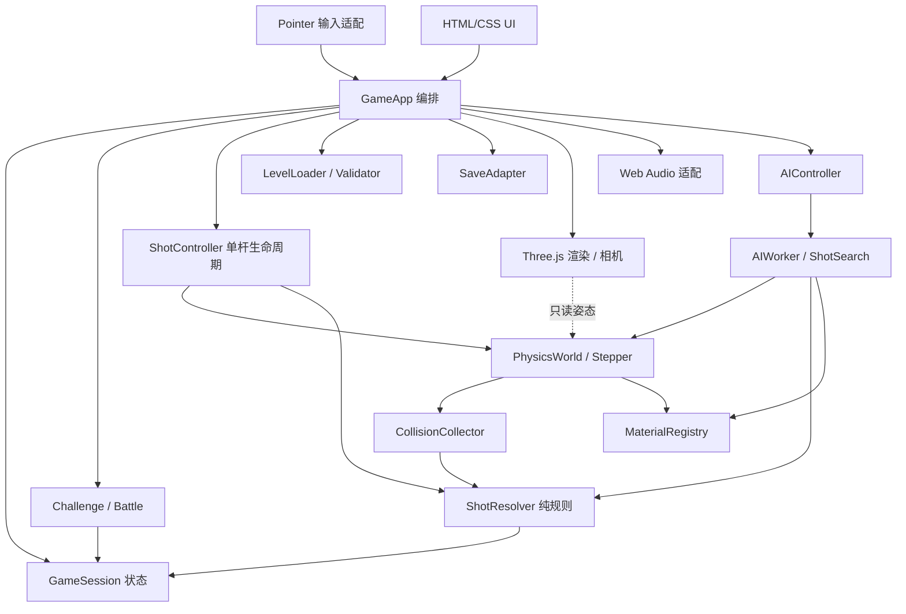
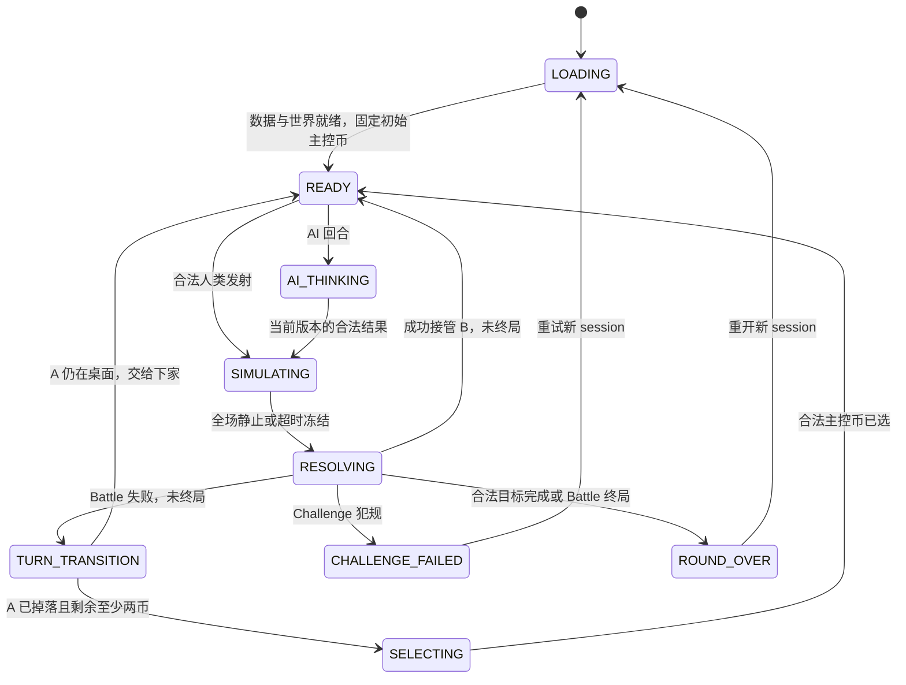

# FlickChain《一弹到底》技术架构 V0.2

版本：V0.2 · 日期：2026-10-09 · 状态：实现前设计，尚无产品代码与运行验收。

本文件把产品规则转为模块边界和实现契约。产品范围以 `docs/PRD.md` 为准，阶段任务以 `docs/TASK_PLAN.md` 为准；若三份文档冲突，应先统一契约再实现。本文中的目录、接口片段和参数均为规划，不表示已经创建、运行或通过测试。

## 1. 依据与设计状态

| 项目 | 状态与来源 |
| --- | --- |
| Web 3D、所有硬币公共、Challenge 任意犯规失败 | 项目聊天「小游戏玩法设计」及用户修正，视为硬约束 |
| TypeScript + Vite + Three.js + Rapier 3D WASM，HTML/CSS、Pointer Events、Web Audio | 源聊天技术方向及项目约定 |
| 整杆判定、静止后移除 A、接管 B 终点、保留 Battle 残局 | 产品规则契约，所有模式共用 |
| Last Coin 为 MVP 对战、平分显示平局、TIMEOUT 零分冻结后换人 | 本轮采用的 V0.2 默认，不阻止开工；写入版本化规则，阶段 3 试玩评估，变更更新决策记录 |
| 120 Hz、静止阈值、材质系数、AI 搜索预算、画质档位 | 调校候选，必须以实际模拟和手机验证决定 |
| 20 个关卡、后续 AI、平台接入 | 分阶段交付范围，不能提前当成已验证能力 |

初期运行完全离线：不需要账号、服务端或平台 SDK。未来联网只预留边界，不加入 MVP 开发链。画面为精致微缩桌面／玩具摄影感，先用木桌与标准硬币。竖屏 9:16 与桌面横屏 16:9 改变相机、布局和画质，不改变桌面几何、材质、力度范围或规则。

## 2. 分层与依赖方向

核心是无 Three.js、DOM 和浏览器事件依赖的状态与规则。Rapier 类型封装在物理适配层；Core 和规则使用项目自己的数值结构、稳定 ID 和事件。实际物理适配层可在主线程与 Worker 中复用。



箭头表示调用／数据依赖，不表示各模块可互相写状态。只有 `GameSession` 通过合法命令提交业务状态；只有 `PhysicsWorld` 创建、推进、删除物理对象。渲染消费只读姿态，不能把 Mesh 位置写回物理。模式负责胜负与换人，不复制碰撞判定。UI 展示状态，不自行推断是否轮到玩家。

### 2.1 目录规划及职责

```text
src/
  types/contracts.ts             共享 DTO、命令、事件、版本与错误类型
  core/GameSession.ts            状态、分数、主控币、提交幂等性
  physics/PhysicsWorld.ts        Rapier 初始化、实体映射、快照与销毁
  physics/PhysicsStepper.ts      固定步时钟、静止检测、超时终止
  physics/CollisionCollector.ts  接触归一化、全杆去重、掉落检测
  physics/MaterialRegistry.ts    唯一物理／表现材质定义源
  gameplay/ShotResolver.ts       无环境依赖的整杆判定
  gameplay/ShotController.ts     发射、收集、锁定、结算与清理
  modes/ChallengeMode.ts         目标、失败、重试与关卡完成
  modes/BattleMode.ts            玩家、连续得分、换人、终局
  app/GameApp.ts                 启动、模块连接、暂停、恢复、重开
  ai/AIWorker.ts                 Worker 消息与物理 clone 生命周期
  ai/AIController.ts             请求版本、取消、结果验证
  ai/ShotSearch.ts               候选生成、评分、搜索预算
  content/LevelLoader.ts         数据读取、版本解析
  content/LevelValidator.ts      结构、几何、目标和解回放验证
  rendering/                    场景、相机、Mesh、光影、插值
  input/                        Pointer 手势、桌面投影、输入取消
  ui/                           菜单、HUD、模式提示、结果与无障碍
  platform/SaveAdapter.ts        本地进度、设置、迁移；后期平台适配
public/                         静态资源；不保存运行状态
tests/                          纯规则、生产物理回归、生命周期测试
```

主协调者拥有 `types/`、`app/`、包及构建配置和跨模块连接。物理／规则、表现、AI／内容、平台分别按项目角色分工；共享接口先由主协调者定稿。上述文件尚未存在时也不得多人同时创建不同版本的契约。

## 3. 坐标、单位与输入契约

采用右手世界坐标：桌面为 XZ 平面，Y 向上。内部统一 SI：长度 m、时间 s、质量 kg、线速度 m/s、角速度 rad/s、冲量 kg·m/s。美术可用缩放后的视觉尺寸，但输入、判定与 Rapier 只使用世界单位。硬币半径、厚度、质量、重心、桌面尺寸及重力放入版本化配置，禁止散落在渲染或 AI 中。

呈现层使用 `THREE.PerspectiveCamera` 的 3D 透视视角。空白桌面上的 Pointer 拖动改变相机 yaw/pitch；相机当前 forward 投影到 XZ 平面，作为唯一的弹射方向来源，保证“弹出去始终是当前视角前方”。起手和每次换人先进入 `selecting`：点击任意仍在桌上的公共硬币，镜头平滑跟随该币并显示选中标识；点击确认后才进入 `ready`，此时只能拖动当前币蓄力，松手沿相机前方发射。屏幕像素只映射力度，不再把拖拽向量当作世界方向，UI 以归一化力度 `power01` 展示。固定发射模型不增加自由打击高度或偏心旋转控制；拖动死区、最大拉距、相机灵敏度与最大冲量仍需设备调校。

无效输入必须在调用物理前拒绝：NaN／Infinity、零方向、超范围力度、未知／已删除 coinId、错误玩家、错误 sessionId／stateRevision、未获发射权限、第二根指针。有限且合法的力度可按约定限幅；结构错误不静默修正。`pointercancel`、失焦、切模式、暂停、重开和视口变化取消未释放的手势，不产生一杆。开始 AI 请求时也取消人类手势。

区分人类 UI 门禁与统一命令接收门禁：`canHumanAct` 仅在 READY 且当前 owner 为人类时成立；`acceptShot` 接受此状态下的人类命令，或 AI_THINKING 下当前 AI owner、requestId、sessionId 与 revision 全部匹配的 AI 命令。SIMULATING、RESOLVING、TURN_TRANSITION、SELECTING、暂停、终局与 ERROR 对双方都拒绝发射。AI_THINKING 拒绝人类操作，不拒绝合法 AI 发射；不存在临时把 AI 回合标为人类可操作的窗口。

以下仅为文档中的接口草案，不是已实现代码：

```ts
type CoinId = string;
type PlayerId = 'P1' | 'P2';
type Vec3 = Readonly<{ x: number; y: number; z: number }>;
type SessionPhase =
  | 'LOADING' | 'SELECTING' | 'READY' | 'AI_THINKING'
  | 'SIMULATING' | 'RESOLVING' | 'TURN_TRANSITION'
  | 'CHALLENGE_FAILED' | 'ROUND_OVER' | 'PAUSED' | 'ERROR';

interface CommandStamp {
  sessionId: string;
  stateRevision: number;
}
interface ShotCommandBase extends CommandStamp {
  commandId: string;
  playerId: PlayerId;
  sourceCoinId: CoinId;
  directionXZ: Readonly<{ x: number; z: number }>; // 已归一化
  power01: number;
}
type ShotCommand = ShotCommandBase & (
  | { issuer: 'HUMAN' }
  | { issuer: 'AI'; requestId: string }
);
interface ShotContext {
  sessionId: string;
  shotId: string;
  startRevision: number;
  playerId: PlayerId;
  sourceCoinId: CoinId;
  startStep: number;
  configVersion: string;
  ruleVersion: string;
}
interface PhysicsEvent {
  sessionId: string;
  shotId: string;
  step: number;
  sequence: number;
  kind: 'COIN_CONTACT' | 'ENV_CONTACT' | 'COIN_FELL';
  coinIds: readonly CoinId[]; // 接触 pair 按稳定 ID 规范排序
  environmentId?: string;
}
interface ShotResultBase {
  sessionId: string;
  shotId: string;
  sourceCoinId: CoinId;
  fallenCoinIds: readonly CoinId[];
  foulReasons: readonly string[];
  terminalStep: number;
  termination: 'WORLD_SETTLED' | 'TIMEOUT_FROZEN';
  finalCoinTransforms: Readonly<Record<CoinId, {
    position: Vec3;
    rotation: Readonly<{ x: number; y: number; z: number; w: number }>;
  }>>;
}
type ShotResult =
  | (ShotResultBase & {
      status: 'SUCCESS';
      targetCoinId: CoinId; // 合法成功必须有唯一 B
      fallenCoinIds: readonly [];
      foulReasons: readonly [];
      termination: 'WORLD_SETTLED';
    })
  | (ShotResultBase & {
      status: 'MISS' | 'FOUL' | 'TIMEOUT';
      targetCoinId?: never; // 失败无有效接管目标；接触事实留在事件记录
    });
```

实际接口应采用判别联合，禁止 SUCCESS 无目标、SUCCESS 带掉落／超时，或失败带有效接管目标等无效状态。`shotId` 只在合法命令被接受后生成，`commandId` 用于防止重复释放，`stateRevision` 每次业务状态提交单调增加。所有异步回调同时校验 sessionId、shotId 和对应 revision；旧 UI 命令、旧指针释放、旧 Worker 结果和旧世界事件只能丢弃，不能影响新局。`ShotResult` 只提交一次。

## 4. 物理世界与固定时钟

### 4.1 物理对象

标准币使用真正的动态 3D 圆柱刚体，保留重力、Y 轴平移与离桌掉落；木桌和普通墙／障碍使用固定碰撞体，掉落区域使用传感器及高度兜底。桌面稳定方案初选为：在稳定桌面支撑上锁定 X／Z 转动，允许 Y 旋转；失去该支撑后解锁 X／Z，让硬币自由翻落。该约束来自源方案，是待原型验证的显式设计，不声称币在桌上具有完全自由的翻滚物理，也不把世界替换为二维碰撞。

支撑状态切换在固定物理步边界进行，需防止桌边反复锁定／解锁和姿态突跳；是否允许重落桌面的币重新稳定锁定，以及稳定确认步数，在阶段 1 测试后定稿。约束状态及切换参数纳入 PhysicsConfig／快照，实玩、AI 和回放共同使用。优先用简单凸形状，模型细节由 Mesh 表现。圆柱、凸体与传感器能力以 [Rapier Colliders 官方说明](https://rapier.rs/docs/user_guides/javascript/colliders/) 为依据；具体包版本和碰撞配置在安装时核对并锁定。

每个币拥有独立、不可复用的 `coinId`；建立 `coinId ↔ rigidBodyHandle ↔ colliderHandles` 映射。Rapier handle 不作为业务 ID，也不持久化为关卡 ID，因为已删除对象的 handle 可被引擎复用。销毁时清理双向映射、接触缓存及渲染实体；事件应在删除前转换为稳定 ID，并验证所属世界世代。

`MaterialRegistry` 是材质单一来源：materialId、版本、质量或密度、摩擦、恢复系数、组合规则、阻尼候选及视觉／音效引用。注册表校验有限值、物理范围和引用；表现参数与物理参数明确分栏。实时世界、AI 和解回放使用相同物理参数。不得在 AI 中提高摩擦以缩短搜索，再把结果当成真实解。

最大冲量、薄币和薄墙需要专门穿透测试，必要时开启并评估 CCD。CCD、求解迭代数和接触配置属于 PhysicsConfig，而不是临时帧级开关。具体最佳组合仍需实测。

### 4.2 步进、积压与暂停

`PhysicsStepper` 使用固定 `dt`。120 Hz 是初始候选，阶段 1 比较 60 与 120 Hz 的穿透、弹性、规则一致性和手机成本后选择。一个已开始的世界不能按渲染 FPS 自动改变 dt；选定配置写入快照、关卡解与回放元数据。

主线程以渲染时钟累计 elapsed，每次按固定 dt 推进若干步，再渲染前后姿态插值。每帧最大子步数、最大累计时间都是显式配置。发生长帧时可以减少渲染工作或让游戏时间暂时慢于墙钟，不能跳过物理步、放大 dt 或漏收碰撞；超出积压上限的墙钟时间按显式策略丢弃并记录指标。规则超时只统计实际执行的模拟步。

切后台、系统挂起或显式暂停：冻结模拟、取消指针、暂停音频、使 AI 请求失效；恢复时清空墙钟积压，回到暂停前的安全业务状态，禁止一次补跑几秒物理。暂停中的 SIMULATING 只能从同一世界继续，不能重新发射。`PAUSED` 保留原 phase 与 shotContext；UI 的暂停是覆盖状态，不丢失当前杆。

AI clone 使用同一 fixed dt 独立推进，没有渲染插值或墙钟积压。每次物理步的顺序固定：推进 → 收集／归一化事件 → 检查掉落 → 更新全场静止计数 → 检查模拟步上限 → 给控制器状态。事件必须在静止／超时判定前消费。

### 4.3 WorldSettled 与掉落生命周期

全场静止不是只看 A，也不是某币瞬间速度低。所有仍参与桌面的动态币须同时满足：线速度与角速度低于阈值、在桌面或允许的稳定支撑上、连续满足 N 个物理步。支撑检测应结合接触／几何检测；跳到最高点的低速币不算静止。睡眠状态可辅助，不能替代支撑和掉落检查。阈值与 N 换算为时间并纳入配置，60/120 比较时保持判定时间意图一致。

coin 生命周期：`ON_TABLE → FALL_CONFIRMED → REMOVED`。越过明确的掉落体积／不可返回高度即记录 COIN_FELL，只记录一次；单纯短暂离地或靠近边缘不是掉落。确认掉落后该币退出可选列表，在物理步之间安全删除，不再等待它落到无限深处。所有币掉落都影响本杆，即使掉落币不是 A 或 B。

正常结算必须等待所有保留币满足 WorldSettled。允许的稳定支撑须来自桌面或关卡明确许可的固定障碍；以 A 或其它动态币为垂直支撑不满足可接力条件。成功提交前检查移除 A 不会破坏 B／其它币的支撑，若检查不成立，保持原世界与零新增得分，进入可恢复 ERROR，不能先删除再尝试判犯规。安全移除 A 后检查 B 的真实位姿与支撑，再开放输入；不得把漂浮币交给玩家。该错误是配置／物理恢复异常，不增加新的正常玩法规则。

### 4.4 防止永不静止：TIMEOUT

每杆设最大模拟步数 `maxShotSteps`，按候选模拟秒数除以 dt 得出。TIMEOUT 不按真实等待秒数触发，暂停和慢设备不消耗额外模拟预算。

达到上限后先消费最后一步事件，再记录 TIMEOUT；本杆零分，不能由已有 A-B 接触转为成功。V0.2 默认把 TIMEOUT 视为犯规：Challenge 失败，Battle 在安全边界内换人。停止该杆物理推进，冻结保留币的终态并清零速度／角速度，只清理已确认掉落币，记录 `termination: TIMEOUT_FROZEN`；不执行成功删 A。禁止发射直到冻结、支撑合法性及业务提交完成。

若所有保留币的终态均有合法稳定支撑，可提交零分残局，在新杆前恢复同一动态世界；恢复不得改变位姿。若存在尚未满足掉落条件的悬空／非法支撑币，保留冻结终态并进入可恢复 ERROR，不换人开放下一杆，不把它凭空归为掉落，也不删除存活 A。提供重建本局／返回菜单，并记录异常证据。未来若增加专门的冻结恢复策略，须先更新规则版本并证明不会造成杆外掉落；当前安全默认不继续该残局。

冻结是超时兜底，不冒充 WorldSettled，也不回滚本杆位置。Battle 使用处理后的终态残局。该路径需专项验收：冻结、额外清理、比分终局及下一个玩家选择不会产生输入窗口。正常成功路径禁止使用冻结来凑足静止条件。

## 5. 全杆事件与规则判定

### 5.1 一杆的采集边界

从发射冲量被接受的物理步开始，到 WorldSettled 或 TIMEOUT_FROZEN 为止。碰撞采集使用接触开始事件，并在配置中启用需要的事件能力；传感器交叠不能误算硬币命中。每步先用规范化 pair 去除同一币多个 collider 的重复；整杆再用稳定 ID 集合去重目标。事件携带 step 和 sequence，按确定顺序归约，同一步涉及多个目标不能由回调先后决定合法性。

关卡初态禁止硬币相互穿透或以不稳定接触启动。对静止起始接触建立基线：没有新碰撞的持续接触不当成一杆新命中，基线也不能掩盖发射后的新增第三币接触。实物几何接触的判定是默认；若需要冲量阈值排除数值抖动，应先形成版本化规则并验证，不在表现层随意滤掉轻碰。

`ShotResolver` 累积整杆接触图与掉落集，但目标集合只取源币 A 的直接 coin-coin 接触。合法候选可以是 A-B，随后 B 再撞 C、D 仍只保留 B 一个目标；反复 A-B 接触仍是一个目标。出现 A-C 或 A 与另一新增硬币的直接接触时，记录额外硬币接触犯规。B-C、B-D 等下游链路不构成额外目标。普通墙／障碍接触只用于物理和反馈，不增加目标，不构成犯规。特殊障碍若未来有规则，须新增明确类型与验收。

### 5.2 早期失败与最终提交

| 情形 | 运行中反馈 | 最终结果与动作 |
| --- | --- | --- |
| A-B，之后静止且无其它接触／掉落 | 可显示待确认命中，分数不变 | SUCCESS：+1，安全移除 A，主控设 B 的物理终点，同玩家继续 |
| A-B 多次，或 A-墙-B | 同上 | 唯一 B，无犯规，SUCCESS |
| A-B 后 B-C/D，或 A 同步直接撞 B/C | 前者继续收集物理事件；后者一旦确定立即锁失败／犯规 | 前者按唯一 B 结算 SUCCESS；后者 FOUL：零分；Challenge 失败，Battle 结算后换人 |
| 没有命中其它币 | 运行中仍等待可能回弹 | 静止后 MISS：零分；模式按犯规处理 |
| 任意币掉落，即使此前命中 B | 一旦确定立即锁失败／犯规 | FOUL：零分；清理掉落币，保留其余终态 |
| 达到最大模拟步 | 立即锁定超时提示 | TIMEOUT：零分，按冻结兜底完成结算 |

Challenge 的失败提示可以在物理仍推进时出现，但“重试”只能在安全结算／清理完成后完整重建世界，同时更换 sessionId，不能直接复用旧世界。退出意图可先记录，安全销毁后再切场景。不能因屏幕显示失败就停止收集已发生的掉落。Battle 的换人提示可以预告，但下一杆输入只能在安全结算并提交后开放。

最终提交是一个业务事务：验证 session/shot/revision → 固化结果 → 更新剩余币／主控币 → 成功时计分一次并移除 A → 根据模式检查终局／换人 → 增加 revision → 发布只读状态。失败不能移除仍留在桌面的 A，也不能重置其它币。重复回调不得重复加分、重复删除、换人两次或打开失效输入。

## 6. 状态机与模式



所有活动状态可进入 PAUSED，数据／WASM／世界错误可进入 ERROR；这些覆盖转移未在图中展开。发射授权遵守第 3 节 `acceptShot`：AI_THINKING 仅接受当前有效 AI 命令，其余禁入状态对双方拒绝。光圈、HUD 玩家名、鼠标／触摸命中区和键盘辅助入口必须从同一 `canHumanAct` 状态派生。SELECTING 使用独立 `canHumanSelect`／选币命令验证，不开放发射。

### 6.1 Challenge

关卡定义保留一个默认起始币用于解法回放和教学提示，但运行时从 `SELECTING` 开始，玩家可从至少两枚公共币中选择任意一枚作为第一杆主控币。MVP 目标为 `CLEAR_ALL`：从至少两币的合法初态连续接力，最后一杆合法移除 A 后只剩一币才通关；正常 N 币需 N−1 次成功。目标类型仍写入关卡数据以便未来扩展。任何 MISS、额外碰币、任意掉落和 TIMEOUT 都失败。剩余币数因掉落降至 1 或 0 不算通关；通关只由有效 SUCCESS 提交触发。

重试恢复版本化初始关卡，而非回滚最后一杆。重试清理物理 world、事件队列、拖动、插值缓存、音频状态和 AI 请求；旧 Worker 消息不能对重试局生效。

### 6.2 本地 Battle：Last Coin 建议默认

两名玩家共用所有硬币；选币只是主控指定，不创建所有权。起手与每次失败换人都进入 `SELECTING`，由当前玩家从仍在桌上的公共币中选择并确认。合法 SUCCESS 得一分并继续；失败后将选择权交给下家。失败未掉落的 A 仍保留在真实位置，仍可被下一玩家重新选中；A 已掉落时只能从剩余币中选择。

人机模式进入 SELECTING 时，由当前玩家 owner 决定选择来源：人类显示剩余公共币选择 UI；AIController 按有限预算的选币策略选择有效剩余 coinId，并通过同样的 sessionId／revision／playerId 校验提交选币命令。不得等待人类替 AI 选币。选币不移动币，成功提交后到 READY，再发起 AI_THINKING 搜索；选币结果过期或取消时丢弃，失败时采用明确的合法回退选择。人类在 AI 选择阶段仍无操作权。

安全结算后剩余至多一币即结束，按累计分数决定胜负；V0.2 默认平分显示平局，不自动加入无限加赛。有效最后一次 SUCCESS 先计分，再检查终局。因犯规掉到至多一币也结束 Battle，但该杆零分；Challenge 同情形仍失败。棋盘数据固定初始主控币，Player 1 首局先手，“再来一局”交替先手。这些模式默认写入版本化配置，阶段 3 试玩评估公平性。

当 A 仍存在但终态不适合继续（超时非法支撑等），不得静默选择另一个币规避规则，需先执行已定义清理／错误策略。模式负责决定选择入口，输入层不能绕过。

## 7. Worker AI 与预测

阶段 4 再启用 AI。AI 搜索和可选瞄准预测均复用生产 PhysicsWorld、PhysicsConfig、MaterialRegistry 与 ShotResolver，不另写简化弹球公式。瞄准预测是否在 MVP 出现另由 PRD 决定，架构不要求提前实现。

官方 Rapier 支持世界快照字节及恢复，见 [Serialization](https://rapier.rs/docs/user_guides/javascript/serialization/)。物理快照不等于游戏快照：项目还必须封装稳定 coinId 映射、主控币、剩余币、材质／配置／规则版本和构建元数据。恢复时验证映射与数量，禁止仅凭裸 collider handle 关联业务。

```ts
interface SimulationSnapshot {
  schemaVersion: number;
  sessionId: string;
  stateRevision: number;
  physicsBytes: Uint8Array;
  coinBindings: readonly {
    coinId: CoinId;
    bodyHandle: number;
    colliderHandles: readonly number[];
    materialId: string;
    rotationConstraintState: 'TABLE_LOCKED' | 'FREE';
    supportStableSteps: number; // 保留约束切换的业务计数
  }[];
  activeCoinId: CoinId;
  physicsConfigVersion: string;
  materialVersion: string;
  ruleVersion: string;
  rapierVersion: string;
  levelVersion: string;
}
interface AIRequest {
  requestId: string;
  snapshot: SimulationSnapshot;
  budget: { candidateLimit: number; simulationStepLimit: number; wallTimeMs: number };
  seed: number;
}
interface AIResponse {
  requestId: string;
  sessionId: string;
  stateRevision: number;
  shot: ShotCommand | null;
  evaluatedCandidates: number;
  reason: 'FOUND' | 'BUDGET' | 'CANCELLED' | 'ERROR';
}
```

传输快照时复制专用 bytes，再 transfer 复制品；不得 detach 正被主世界或其它搜索持有的 buffer。每个候选从同一初态恢复 clone，结束／取消／异常均显式释放 world 与事件队列。搜索复用缓存也必须验证版本，不能复用已推进世界作为另一个候选的起点。

搜索候选可从方向与力度离散采样开始，再围绕有效方案局部细化。得分优先考虑合法成功，其次是同玩家续杆后的可接力性和风险；不能把掉落减币当成收益。所有候选有单杆步数上限、总候选／模拟步预算及响应墙钟预算。分层难度优先改变候选数量、采样密度及选择策略，保持真实物理一致。

预算初步候选为数百毫秒至约一秒量级的思考等待；候选数和并发 clone 数以手机测量确定，默认单 Worker 不多开 clone。同步长循环会阻塞 Worker 消息，因此取消必须通过分批 yield 后检查令牌，或由主线程 terminate 并重建 Worker；只发送 CANCEL 不足以保证即时停止。暂停、重试、切模式、选币或 revision 改变均使请求失效。

AIController 接受结果前校验 requestId、sessionId、revision、主控币和所有输入范围，再通过带 `issuer: 'AI'` 的 ShotCommand 及 `acceptShot` 发射。预算到期若有合法候选可返回它；否则返回 null，由显式降级策略产生一个合法力度／方向命令，并接受真实杆的零分风险；不得直接跳过轮次或保证必胜。Worker 崩溃应结束思考状态并提供重试或本地双人选择。暂停恢复到 AI_THINKING 时重新创建有效请求，不能继续等待已取消的旧请求。

Vite 的 Worker 构建方式依据 [Web Workers 官方文档](https://vite.dev/guide/features#web-workers)，实际实现时选择静态可分析的入口，验证开发和 production 路径、WASM 资源路径以及 Worker 初始化失败。具体 API 语法随锁定版本再核对。

### 7.1 可复现性范围

[Rapier Determinism 官方文档](https://rapier.rs/docs/user_guides/javascript/determinism/) 的一致性有前提：同版本、同初态、同参数与对象增删顺序，初始化数值也要来自一致的计算。项目固定 seed、实体排序、模拟步数、输入序列和所有配置，并保存元数据；不作无条件跨设备精确一致承诺。录制一次发射不等于可在任意未来版本重放。

## 8. 关卡与内容验证

LevelData 至少包含：schemaVersion、levelId、levelVersion、桌面尺寸／障碍／掉落区域、稳定 coinId 列表及初始 transform／materialId、起始主控选择规则、ChallengeObjective、PhysicsConfigVersion、MaterialVersion，以及可选的验证解引用。几何和玩法数据不能从 Three.js 场景反推。

加载分两步：先做结构／引用检查，再用生产物理验证初态。检查唯一 ID、有限数值、正尺寸、单位四元数、有效材质、合法币数、目标可达到的计数范围、币在桌面内、无相互穿透／危险边缘、无无效障碍和初始掉落；初态预稳定后记录规范快照，若稳定导致重大布局变化则关卡不合格，不能静默接受。

阶段 5 的 20 个关卡，每关至少有一条通过生产规则的完整合法解。SolutionReplay 保存 level/config/material/rule/Rapier 版本、初始快照标识、seed 和逐杆输入语义（sourceCoinId、directionXZ、power01）、预期结果／目标，不保存可直接投递到新会话的运行期命令。

回放驱动先校验上一杆结果、真实终态和当前主控币，再注入当前 sessionId／stateRevision／playerId，生成新的 commandId；需要 AI issuer 时也必须取得当前有效 requestId。通过正常 `acceptShot` 接收门禁发射，不原样复用历史 session/revision，也不绕过状态授权。逐杆从真实上一杆终态继续，禁止把 B 拉回初始位置。验证所有杆不犯规、有效目标达成，记录角度／力度的小幅扰动成功范围；只找到一次数值巧合的解不足以证明适合玩家。

关卡回放先在锁定环境验证，再在目标浏览器和真实手机抽验；不把桌面离线解验证当作手机可玩性和性能验收。材质、dt 或求解配置变更后重新验证受影响解，旧“已验证”标签随版本失效。

## 9. 表现、性能和本地存档

渲染读物理姿态，画质降级只调整阴影、分辨率、DPR、抗锯齿和效果数量。木材／金属使用统一灯光和尺度，硬币 Mesh 与 collider 尺寸要可视化对照。竖横屏切换保留同一世界状态，更新相机和 UI；拖动过程中取消手势，避免投影突然改变发射方向。

物理候选与渲染候选分开记录：60/120 Hz 对照固定场景；最坏币数、最大冲量、连续墙反弹、掉落与 AI 搜索都做剖析。手机目标帧率可先按 60 FPS 设计、允许验证后提供较低画质档；没有真实手机数据前不承诺稳定帧率、温度或耗电。记录物理／渲染耗时、积压、单杆步数、Worker 响应、峰值内存与重复重试后的资源增长。

碰撞音效由归一化事件触发，限流同帧多次声音，掉落／成功／失败音效服从最终或已确定状态。音频只在用户交互后启用，提供静音；音效播放失败不影响规则。反馈不抢先加分，失败时光圈和命中区同步关闭。

`SaveAdapter` 先使用本地存储保存设置、关卡进度、最佳成绩和版本，不默认持久化半杆中的 Rapier 快照。保存采用 schemaVersion、字段校验和迁移；损坏数据降级到安全默认，保留可诊断原因，不能卡住启动。配额／隐私模式等写入失败只影响持久化，界面应明确本次进度未保存。重置进度是独立用户操作。

## 10. 错误恢复与资源所有权

| 失败点 | 处理约束 |
| --- | --- |
| WASM 加载／初始化失败 | 停在 ERROR，显示重试；无输入与空白伪对局 |
| 关卡结构或版本不匹配 | 阻止开局，报告 levelId 与失败原因，不猜测材质 |
| 非有限物理 transform／世界异常 | 锁输入并结束当前推进，保存诊断，提供重建本局；不得判成功 |
| TIMEOUT 非法支撑终态 | 保持冻结并进入可恢复 ERROR；只清已确认掉落币，不删除存活 A，不开放下一杆 |
| Worker 失败／结果过期 | 释放或重建 Worker；丢弃过期结果；显式降级 |
| UI 切换／重试／卸载 | 取消请求和手势、销毁 world、释放队列与 Mesh／材质／音频资源 |
| 存档错误 | 可继续离线游玩，告知保存状态，不更改对局规则 |

GameApp 是生命周期根。每个模块提供可重复调用的 dispose／cancel；会话替换先使旧 token 失效，再释放资源并创建新世界。事件监听、requestAnimationFrame、Worker、Rapier world 和 Three.js GPU 资源各有唯一释放责任。不要仅移除画布就认为旧对局已销毁。

## 11. 验证矩阵与交付边界

| 层级 | 必须验证的代表场景 | 证明范围 |
| --- | --- | --- |
| 纯规则测试 | MISS、唯一 B、重复 A-B、A-B 后 B-C/D 合法、A 直接 B/C、同一步多币、墙合法、任意掉落、TIMEOUT、重复提交 | ShotResolver 与模式契约，不证明真实碰撞采集 |
| 生产物理回归 | 薄币／薄墙最大冲量、反弹、桌上锁 X/Z 且可 Y 旋转、离桌解锁翻落、支撑切换防抖／无姿态突跳、空中低速、边缘掉落、全场静止、删除／handle 复用、冻结 | 固定配置的真实 Rapier 与显式转动约束行为 |
| 单杆生命周期 | 发射拒绝、早期失败后清理、成功移除 A 与接管 B、暂停恢复、重开、过期 callback | 业务与物理连接，无输入空窗 |
| 模式回归 | Challenge 掉落减币失败、合法最终目标、Battle 连续得分、残局、A 掉落重选、平局、至多一币终局 | 模式完整转移 |
| AI／快照 | clone 初态一致、映射／转动约束恢复、live buffer 未 detach、取消／terminate、过期响应、AI_THINKING 合法发射且人类被拒、A 掉落后 AI 自行选币、预算、资源释放 | 搜索正确使用生产模型，AI 回合不会因权限／选币卡住 |
| 关卡解回放 | 20 关版本化完整解、连续真实终态、扰动、材料更新重验 | 该版本关卡可解证据 |
| 浏览器鼠标 | 选择、拖动、释放／取消、暂停／重试、失败锁定、光圈／HUD／命中区恢复、竖横布局 | 实际渲染及鼠标交互 |
| 模拟触摸 | pointer 多指、滚动干扰、pointercancel、安全区 | 浏览器模拟触摸，不证明真机 |
| 真实手机 | 手感、画面清晰度、60/120 比较、长帧、后台、温升与内存 | 被测设备的体验／性能 |
| 静态发布 | build、WASM／Worker 路径、资源缓存版本、部署页面、浏览器冷启动 | 实际部署站点 |
| CrazyGames | 后期 SDK、Preview、平台交互与平台验收 | Preview 与正式发布分别留证 |

对规则与生产物理使用有意义的定向回归，不写仅复述接口字段的测试。UI 必须实际浏览器交互，CSS 或回调检查不能替代可见画面与命中区验收。文档审查仅证明设计一致性；当前没有游戏测试、真机测试、部署、Preview 或发布通过记录。

## 12. 六阶段依赖与发布边界

1. **Physics／Input**：可启动真实 3D 物理，标准币／木桌、固定时钟、拖动、支撑／掉落与60/120对照；不提前做完整 AI 或平台。
2. **Rules**：完整单杆采集、整杆合法性、一次提交、接力／清理、TIMEOUT与规则回归。
3. **Modes（MVP）**：Challenge 约 5 个有完整解的 CLEAR_ALL 关卡、本地 Battle 全流程、教程／基础音效／本地进度、终局／平局／选币、实际浏览器交互；对 V0.2 默认竞争规则定稿。
4. **AI**：Worker clone、共享判定、预算／取消、难度与手机性能验证。
5. **Content**：材质调校、20 个关卡与解回放、视觉／音频／真机打磨。
6. **Publish**：刷新平台文档与限制、SDK、静态包、上线与平台验收。

发布前再查 CrazyGames 当前 SDK 和上传要求，不在本文硬写可能过期的包大小、素材尺寸或广告门槛。SDK 通过平台适配接入，不污染 ShotResolver；暂停／广告等平台事件须走同一生命周期入口。生成本地包、部署可访问、CrazyGames Preview 可玩和正式平台发布是四个不同结论。网络对战若未来获批，需另写同步／恢复／安全架构，当前不承诺以快照直接完成联网。

## 13. 待定项与主要风险

| 项目 | 决策节点与证据 |
| --- | --- |
| Last Coin、平局、固定初始币与交替先手 | 当前与 PRD V0.2 默认一致；阶段 3 试玩评估公平性 |
| TIMEOUT 步数、冻结非法支撑处理 | 阶段 1／2 用真实难静止场景确定；须与规则版本绑定 |
| 60/120 Hz、静止阈值、CCD／求解迭代、桌上转动锁定切换 | 阶段 1 固定场景与真机对照，选定后不随 FPS 改变；验证离桌解锁和重落桌面策略 |
| 材料摩擦／恢复／阻尼及币尺度 | 先标准币木桌，实测滑行距离、回弹和停稳；变化重验关卡 |
| 极轻碰触、初始接触基线 | 阶段 2 对真实碰撞抖动测试，不私自增加过滤阈值 |
| 成功删 A 后支撑变化 | 禁止不稳定初态，结算后稳定性专项回归；不能悬空交权 |
| AI 等待时间、搜索候选数、取消粒度 | 阶段 4 真机性能决定，验证 Worker 不阻塞交互 |
| 视觉质量与目标设备 | 选择代表手机与桌面浏览器后定义验收，当前没有实测值 |

最大的正确性风险是首碰即加分、只观察 A、B-C 链碰漏记、掉落误通关、冻结误当静止，以及旧事件／旧 AI 响应污染新局。最大的体验风险是物理精度与手机成本失衡、接力终点难操作和界面反馈与真实输入门禁不一致。后续实现应优先建立这些可证伪回归，再增加内容与平台能力。


## 首版实际实现映射（2026-10-09）

首版为 Challenge/Local Battle，保留上述后续扩展契约。为减少未使用抽象，固定步、碰撞采集与支撑检测集中在 `src/physics/PhysicsWorld.ts`；整杆控制与两种模式集中在 `src/core/GameSession.ts`，纯规则在 `src/gameplay/ShotResolver.ts`。相机轨道、选币聚焦和瞄准呈现在 `SceneManager`，指针生命周期、空白旋转、选币候选和当前币蓄力在 `PointerInput`；`GameApp` 串起 `selecting → ready → simulating`，并在 Battle 犯规换人后清空候选。关卡静态 JSON 经 `LevelValidator` 加载，导出 `src/content/levels.ts`。尚未创建 Worker AI、平台 SDK、材质扩展模块。

共享尺寸、力度、固定步和超时均来自 `MaterialRegistry`。物理产生一次性 coin/wall 表现反馈，`drainFeedback()` 消费，永不参与规则计分。历史犯规原因用于提示，输入权限由 ready/selecting、session/revision/当前玩家决定。存档异常走可关闭 notice，棋盘异常走 error 恢复弹窗。

同配置全解回放带 SHA256 指纹；实际验证边界见 [MVP 验证记录](validation/2026-10-09-mvp.md)。
