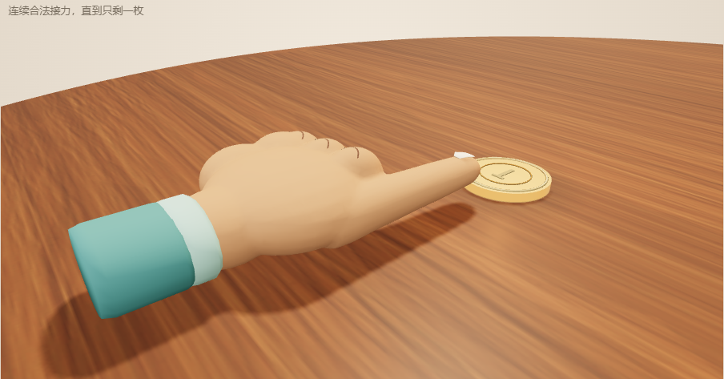
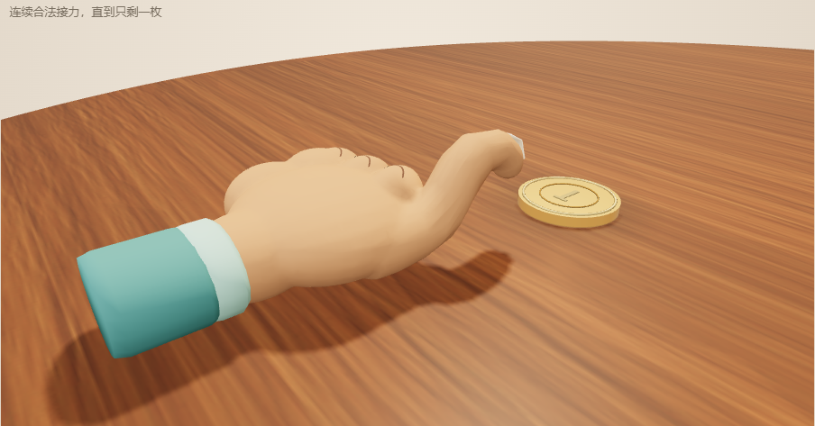
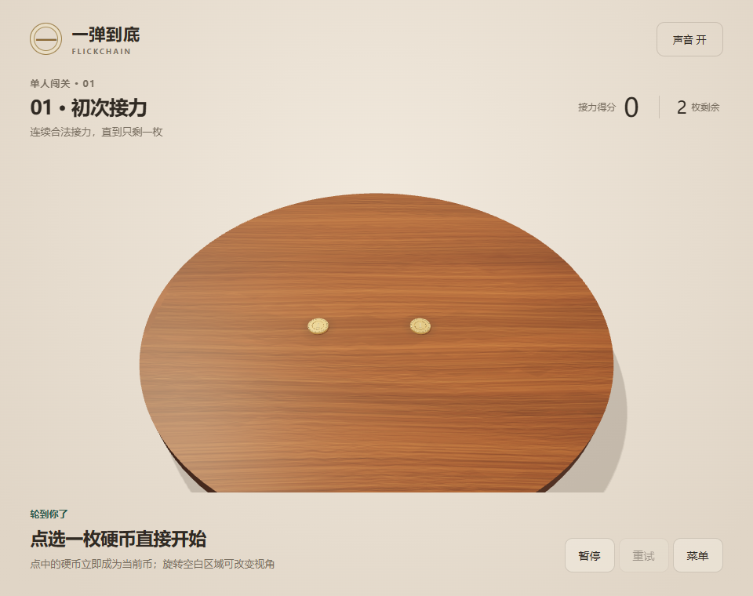

# 连体手与圆桌验收 · 2026-10-10

用户指出上一版手部畸形、破损，要求按卡通握拳参考图用 Blender 重做，食指与手必须一体，默认桌面改为圆桌。此记录取代上一轮模型造型的完成结论；保留上一轮文档作为历史证据。

## 本轮实现

- Blender MCP 连接 Blender 5.1.2，重建项目自有 `FlickHand_Asset` 集合。可编辑源为 `assets/flick-hand.blend`，可重建脚本为 `scripts/create-flick-hand.py`，游戏资源为 `public/models/flick-hand.glb`。
- 拳体、三根收拢的手指、拇指、食指和腕部先焊为同一块 `hand_skin`，再重新计算朝外法线并绑定权重。皮肤4073顶点、6950面；袖口、指甲和指节线仅作为额外装饰。没有分离的 `fist` 或 `index_skin`。
- 12根骨骼包括固定 `hand_root` 和食指11段；保留 `index_mcp`、`index_pip`、`index_dip` 接口。辅助骨骼分摊弧度，减少原先三处大角度弯折的褶皱。`FlickCharge` 为0–24帧、24fps的一秒动作，运行时按蓄力采样；高蓄力抖动沿用外层节点。
- 默认五关和菜单预览为直径1.6米圆桌。圆柱渲染、Rapier圆柱、点击范围、径向边缘解锁和支撑、硬币初始范围与旋转障碍四角校验一致。省略 `shape` 的旧关卡仍为矩形。
- 选币和接力规则沿用：入关或换人可自由选起手币，首杆前可反复切换；合法接力后只从刚击中币继续。

## 执行证据

| 检查 | 结果 |
|---|---|
| Blender原始皮肤拓扑 | 1个连通分量、0开口边、0非流形边、正有向体积 |
| Blender25帧皮肤最低高度 | 每帧最低Y约0.003148米；袖口修正后全部导出网格也通过桌面净空测试 |
| 实际导出GLB回归 | 位置焊接后每条边恰好两面、单一连通；25帧共享顶点不裂、纯根权重拳体保持固定；GPU/CPU矩阵一致性与整手点击覆盖通过 |
| `npm test -- --reporter=verbose` | 84通过，1个按需生成器刻意跳过；11个文件通过 |
| 五关生产解法 | 配置指纹重新生成；完整解分别1、1、2、3、4杆，初态90步预稳定与销毁后再回放通过 |
| `npm run build` | 类型检查与Vite静态构建通过 |
| Chrome鼠标1280×900 | 拳头/袖口蓄力、渐进弯曲、微抖、取消、减少动态效果、自由换币/旋转、实际发射通关通过；无运行错误 |
| Chrome CDP模拟触摸390×844 | 同一交互流程通过，无横向溢出和运行错误；不等同真实手机 |
| 侧面检查 | 待机、半蓄力、满蓄力实际GLB渲染已检查；检查相机只用于查看模型，不改变生产发射方向或物理规则 |
| 加载恢复 | 首次模型请求人为503后，“重建本局”发起第二次请求并恢复，实际成功 |
| 最新dist浏览器加载 | 4174预览加载菜单与第一关，无资源失败；服务返回模型与当前源资源逐字节相同，264232 bytes |

最终模型SHA-256：`55de7a6852687bdc6a6b87c84cd5ac5bb2f7da509e70a6276a8de2126a6a4a96`。

详细结果见 [鼠标与模拟触摸](2026-10-10-continuous-hand-browser.json)、[最新静态构建加载](2026-10-10-round-table-built.json) 和 `assets/flick-hand-authoring.json`。

## 当前截图

## 审查与边界

独立test-reviewer基于提供的源码片段和执行证据未发现可确认的P1/P2问题；子代理沙箱读取失败，因此未独立执行命令、浏览器或截图检查。其指出最终袖口修正后的dist加载需要复测，上表已完成该项。

现有Rapier初始化弃用提示与大JS分块提示仍存在，本轮构建未因此失败。未验证真实手机触摸、手机性能或跨设备回放，也未部署或提交发布平台。
