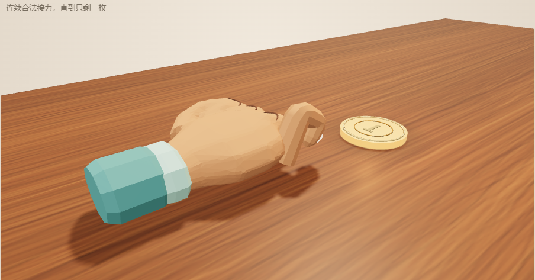

# 2026-10-10 Blender 骨骼手验收

按用户提供的卡通握拳图调整为饱满拳体、三处弯指折线、侧面拇指和单根可动食指。用真实本机 Blender MCP 制作网格、权重、骨骼和动作，导出可编辑 `.blend` 及游戏用 `.glb`，替换程序化拼接手。

| 验证 | 结果 |
|---|---|
| Blender MCP | 5.1.2；插件协议13匹配；独立手场景，没有写已有金币源文件 |
| 导出 | 4骨骼、9网格、1蒙皮、唯一1秒 `FlickCharge`，371704 bytes |
| 真实资产专项 | 10项通过；实际蒙皮顶点渐变、拳体固定、取消恢复、近景40px点击覆盖、失败重试、迟到解析销毁、父变换与渲染矩阵一致 |
| 全测试 | 76通过、1有意跳过（关卡解生成器）；5关生产物理解回放通过 |
| 构建 | TypeScript 与 Vite通过；dist包含相同 GLB；既有大包警告仍存在 |
| Chrome 鼠标 | 1280×900；完整手点击、袖口点击、蓄力、抖动、取消、视角旋转、首杆换币、实际弹射通关均通过 |
| Chrome 模拟触摸 | 390×844；同一流程通过，无横向溢出 |
| 加载恢复 | 浏览器首个GLB请求模拟503，点击“重建本局”后第二次请求成功，恢复游戏 |
| GPU姿态 | 实际鼠标按住，侧面检查相机截图确认平放伸直→C形弯曲；食指尖撤回约6cm |
| 独立审查 | 修正蒙皮绑定逆矩阵同步和无会话加载失败重试；CPU与渲染更新位置一致，资源恰好释放一次 |

实际浏览器流程没有运行错误；有既存 Rapier 初始化弃用提示。真实手机触摸、设备性能和部署未验收。侧面图仅使用检查相机，游戏默认相机和发射方向没有因此改变。

游戏仍按原规则执行：入关或 Battle 换人可自由选起手币，首杆前可换币；合法接力后只能操作刚击中的币。模型不参与物理和得分判定。
