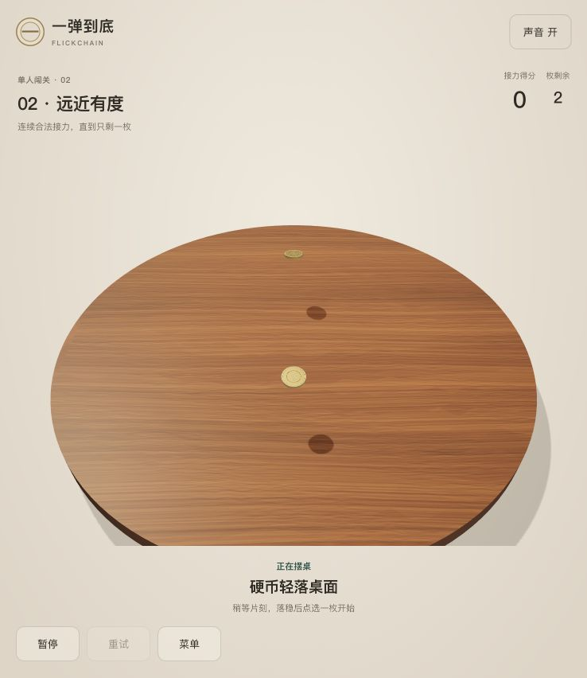

# 用户动画手、力度与音效验收

日期：2026-10-11。验证对象为本地FlickChain游戏与静态构建，GitHub源码同步和线上部署分别记录。

## 当前改动

- 用户源模型为 `blender/pointing-hand-rigged.blend`，保留骨骼和蒙皮；导出副本映射一秒 `FlickCharge`，手背朝上、缩放为上一版80%、统一皮肤材质。源模型袖口开口与分部拓扑保留。重导入口见 [模型说明](../../assets/README.md)。
- 最大冲量从0.024增至0.048 N·s，蓄满仍为1.25秒。`wood-standard-v2` 每个120 Hz公共步执行两个240 Hz内步，逐内步采集接触并聚合事件。
- 桌边只有币心越界或实际离桌才解锁倾倒，币缘悬出和瞬时接触缺失不会造成自行倾斜位移。
- `CoinArrival` 让硬币依次从约18cm高度轻落、微回弹并发出叮当声，仅改变呈现；入场锁定选币和发射，暂停冻结时间，重载清掉旧入场和声音。减少动态效果时跳过入场。
- 撞击/木桌/落桌使用真实CC0短录音，滑行仍为低频合成摩擦层，随实际桌上移动渐弱。来源与加工说明见 [音效来源](../../assets/audio-sources.md)。

## 可复现检查

```sh
npm test
npm run validate:levels
npm run build
git diff --check
```

| 检查 | 结果与范围 |
|---|---|
| 全套自动化 | 108项通过，1项按需解法生成器刻意跳过；14个测试文件通过，1个生成器文件跳过 |
| 五关解法 | 24项布局与重放检查通过；新配置指纹与完整解法已重新生成，分别1、1、2、3、4杆合法清盘 |
| 满力碰撞 | 8方向满力薄墙反弹、硬币CCD、完整杆多次接触与犯规/模式回归通过 |
| 稳边回归 | 自动测试覆盖8方向，停稳后续跑600步无掉落或可见位移；独立只读生产仿真覆盖16方向、48世界，32个低力稳边最大XZ漂移1.44e-15m，16个满力越界均恰好报告一次掉落 |
| 呈现与音频生命周期 | 每币只触发一次落桌声；入场输入门禁恢复；静音/暂停/销毁释放声部；切关取消已开始和预约声音并保留解码缓存 |
| 构建 | TypeScript与Vite通过；四个WAV和GLB包含在dist中，资源基址相对；较大JS分块提示仍存在 |

`public/models/flick-hand.glb` 为106380 bytes，SHA-256：`a5d027e6381b2c3ca303b06a86d249f42e06c3a619b1d707ed0f2cb5d6f7b028`。四个WAV合计102488 bytes；独立审查确认public/dist音频哈希一致。

## 浏览器与独立审查

本轮本地浏览器视口738×852，鼠标实测：开局落桌可见、暂停/恢复保留入场进度、落稳后恢复选币、手指625ms蓄力完成第二关；2秒满蓄力将目标推出桌面并正确按掉落失败。控制台未记录运行错误。



独立test-reviewer核对生产完整杆判定、子步事件收集、稳边/越界、入场门禁与音频清理，未发现未解决的阻塞问题。审查发现切关旧落桌音残留，已通过 `stopCurrentSounds()` 修复，并独立复现确认声部归零、节点断开、缓存保留和后续声音可用。浏览器操作由主协调者执行，独立审查没有操作浏览器。

## 证据边界

未验证真实手机触摸、手机性能、实际扬声器/耳机听感、跨设备重放或连续人工难度体验。240 Hz内步增加物理计算量，移动性能仍待实测。Worker AI、20关及平台接入尚未完成；本轮未部署网站、创建GitHub Release或提交CrazyGames。

本轮Git提交包含已验证代码、运行模型、可编辑源模型、音频、解法与文档；本机Codely配置、Blender自动备份和编辑前快照保留本地。
