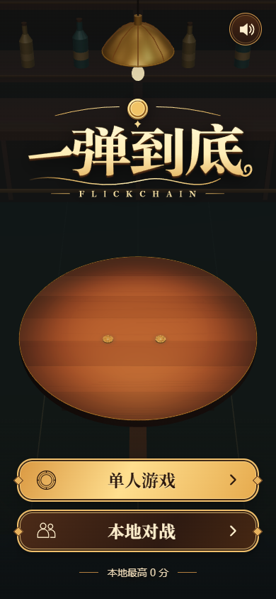
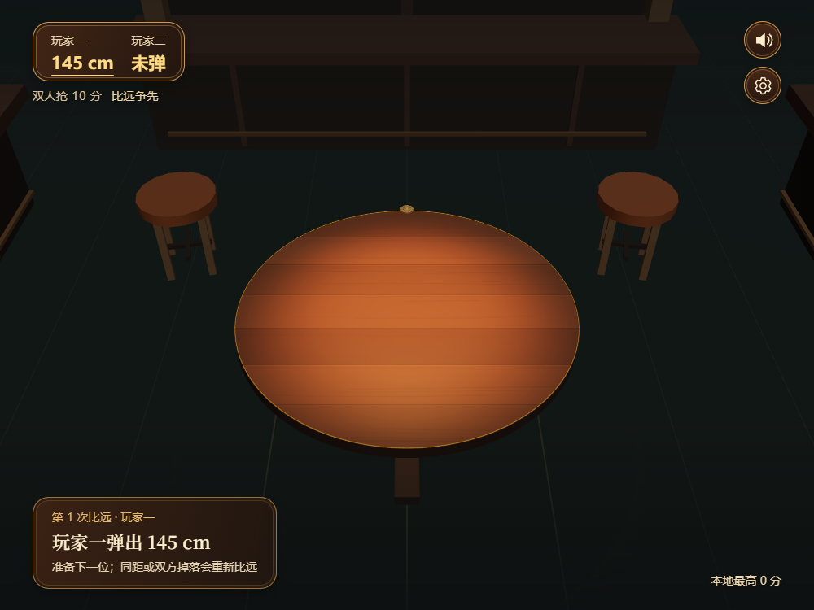
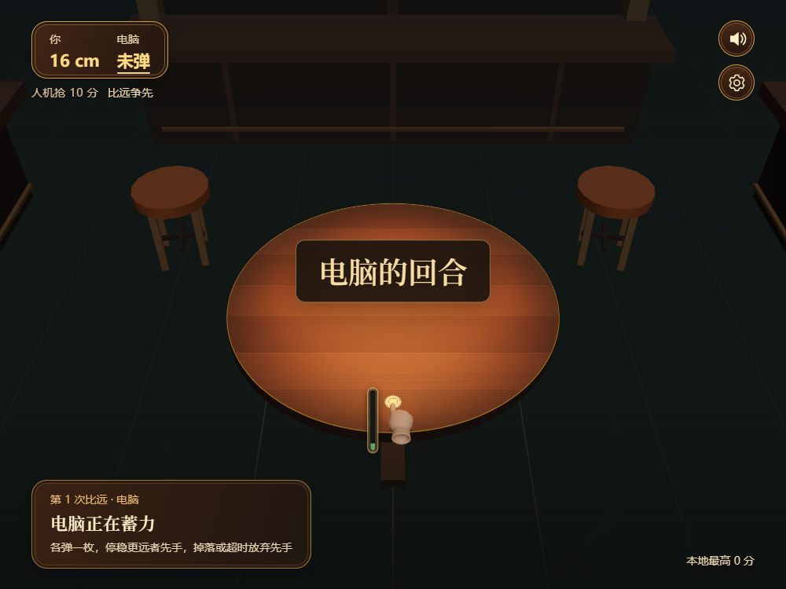

# 2026-10-13 通用分支同步验收

## 范围

- PVE 电脑手指、真实方向与力度的蓄力过程；待发动作在暂停、重开、返回菜单、页面隐藏时取消。
- 开局和正式对战换人的中央提示，中文分支使用中文；接力连分不重复提示。
- 开局比远时实际停在桌沿的半悬硬币正常记录距离和决定先手，真正掉落仍弃权。
- 发光灯泡、开放灯罩内壁、柔和光晕、资源释放和横竖屏吊灯位置。
- 窄屏菜单、比分、结果布局与多目标犯规解释。
- 保留原中文标题、界面、关卡和恢复文本；不迁入英文 Logo、英文封面、平台 SDK、发布包或平台音频/生命周期接口。

## 自动化

`dev_cn`：28 个测试文件通过，1 个可选文件跳过；356 项通过，1 项跳过。
TypeScript noEmit 与 Vite 生产构建通过。
包括真实 Rapier 桌沿停币、实际距离/先手比较、掉落/超时、电脑蓄力方向/力度、动作取消、回合提示、吊灯和资源释放回归。
既有 Rapier 初始化参数弃用提示与 Vite 大块提示仍存在，不影响本次测试与构建结果。

## 浏览器证据

本地 Chrome 浏览器鼠标操作，1000×750；主页另检查 390×844。
为稳定复现桌沿位置，测试夹具仅将鼠标松手产生的力度固定为 0.75；游戏物理、结算和界面保持实际代码。
PVP 开局：硬币中心 z=-0.8080828786、y=0.0028169，圆桌半径 0.8；正常显示“玩家一弹出 145 cm”，timedOut=false。
PVE：实际 Worker 开局决定，界面显示“电脑的回合”和“电脑正在蓄力”，可见手指与 11% 力度条。
无页面错误，未观察到任何平台 SDK 请求。该证据不代替真实手机触摸或公开站点验收。

